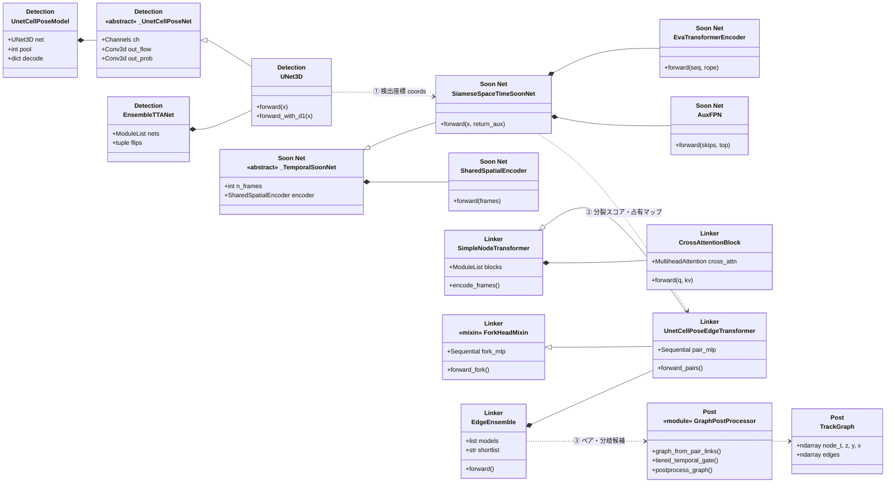
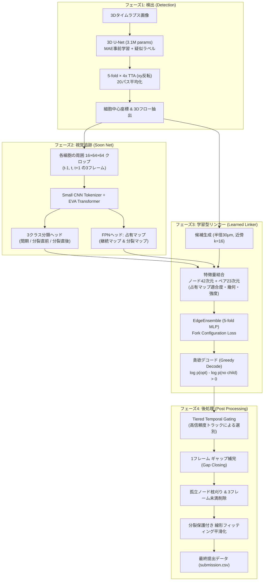
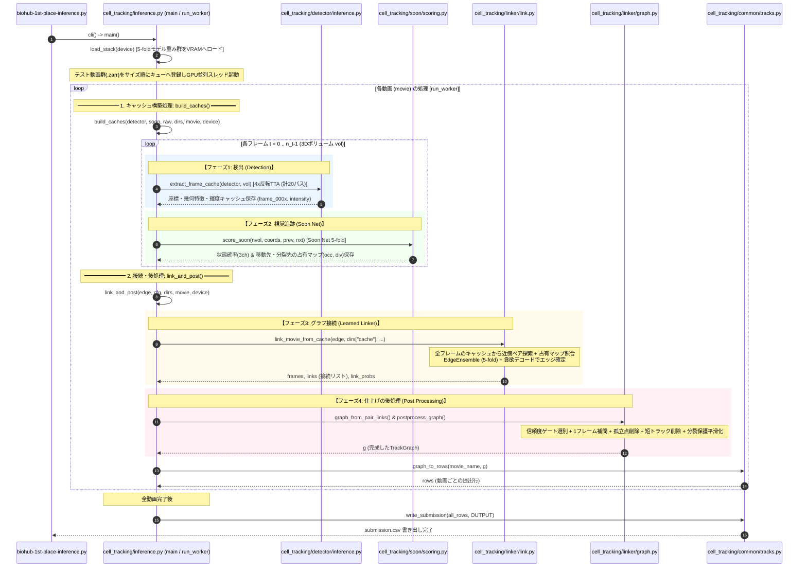
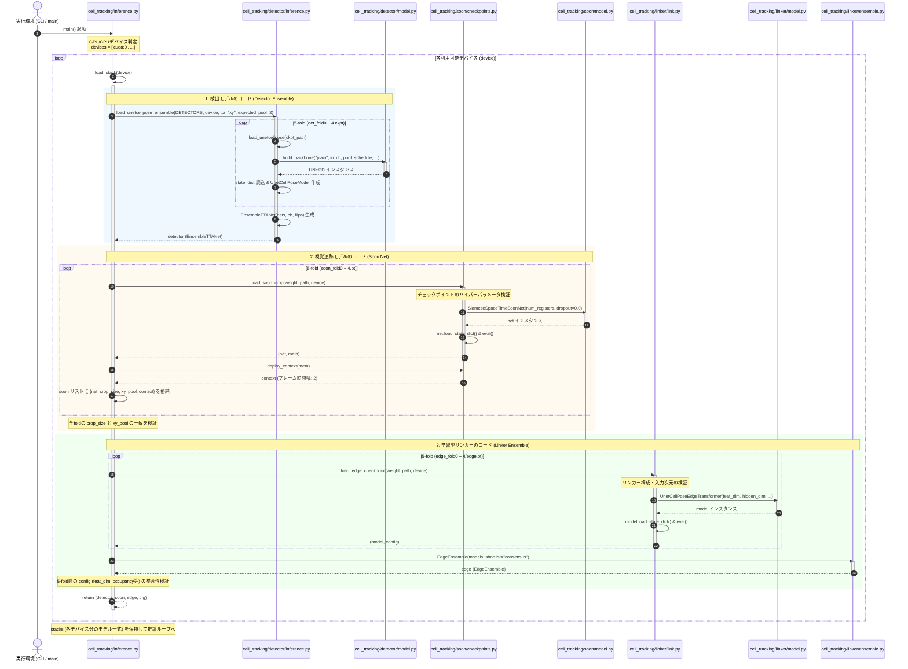
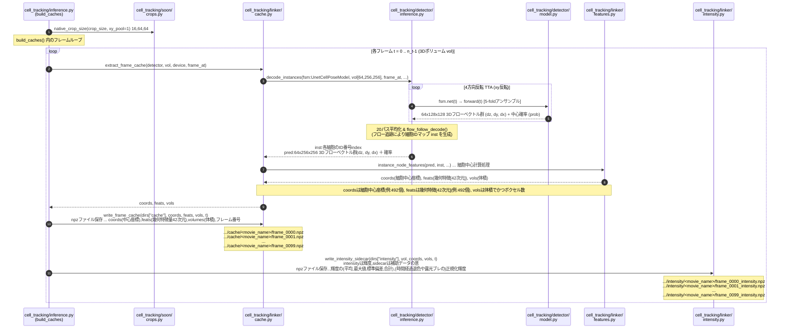
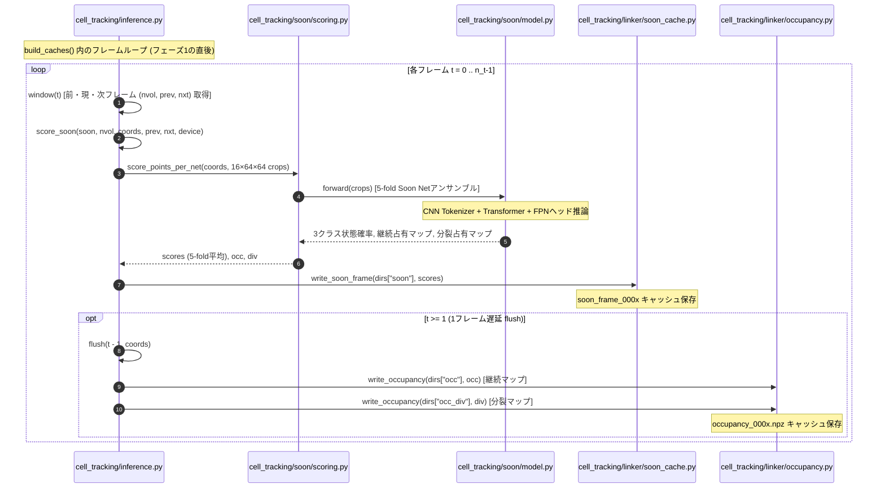
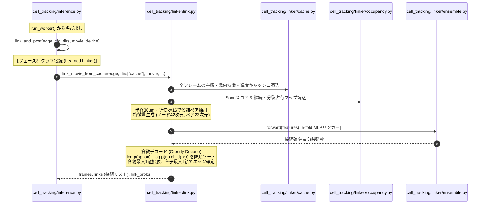
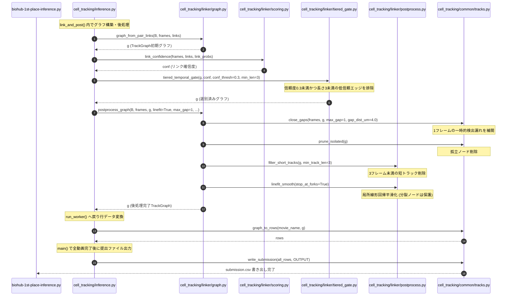

18-⑤Kaggle実践3 Biohub細胞トラッキング：1位解法のまとめ


## Abstract
- biohub 1位解法のまとめ(Public 0.976 / Private 0.977)
- 「幾何学的追跡」から「ビジュアルトラッキング(視覚的追跡)」へのパラダイムシフトにより、CV・LB共に圧倒的スコアで優勝した1位チーム(sersasj)の完全解説。

## 概要
先日、Biohub細胞トラッキングコンペが完了しました。
で、惨敗だった僕の結果(1353位/3800人)はさておき、Kaggleの素晴らしいところは、勝者たちの解法が惜しみなく公開されること。
この学びの宝庫を徹底的に分析し、確実に自身のスキルへと昇華させるべく自分の血肉にしてやりますばい。

## biohub 1位の解法まとめ
1位の方だけでなく、上位陣の人たちはモデルを複数駆使してて、また学習にも工夫が随所にみられました。そして公開されるのは学習後モデルそのものでして、学習に使用したコードやデータ群までは公開されないんですね。ただ上位陣はそれぞれ自身の提出コードの解説ページを公開してくれてて、そこで結構情報を得られたりします。

- 解説のURL
https://www.kaggle.com/competitions/biohub-cell-tracking-during-development/writeups/1st-place-solution
- ソースコード
https://www.kaggle.com/code/sersasj/biohub-1st-place-inference

---

## プロジェクト構成

1位解法のリポジトリ(`biohub-1st-place-reproduction`)および推論処理で使用されている主要スクリプト・重みファイル群の役割・構成一覧です。

```text
biohub-1st-place-reproduction/
├── biohub-1st-place-inference.py       # Kaggle推論エントリーポイント
├── cell_tracking/                      # メインパッケージ
│   ├── inference.py                    # 推論処理全体の統括(main/cli)
│   ├── common/                         # 共通処理(tracks, I/O, 正規化, 幾何計算)
│   ├── detector/                       # 検出器モジュール
│   │   ├── model.py                    # 3D U-Net + Cellposeヘッド定義
│   │   ├── inference.py                # 検出推論・TTA・ピーク抽出
│   │   └── resnet.py                   # 3D ResNetバックボーン
│   ├── soon/                           # ビジュアルトラッカー(Soon Net)
│   │   ├── model.py                    # SoonNet(CNN Tokenizer + EVA Transformer + FPN)
│   │   ├── crops.py                    # 局所3Dボリューム(3フレーム)切り出し
│   │   ├── scoring.py                  # 状態分類・占有マップ推論
│   │   └── checkpoints.py              # 重みロード
│   └── linker/                         # 学習型リンカー(Learned Linker)
│       ├── ensemble.py                 # EdgeEnsemble(5-fold平均)
│       ├── link.py                     # キャッシュからのエッジ推論・貪欲デコード
│       ├── graph.py                    # TrackGraph構築・後処理
│       ├── postprocess.py              # 線形フィッティング平滑化・短トラック除去
│       └── tiered_gate.py              # 高信頼度ゲーティング
└── weights/                            # 5-fold学習済みモデル重み群
    ├── det_fold0.ckpt ~ det_fold4.ckpt # 3D U-Net検出器重み(5-fold)
    ├── soon_fold0.pt ~ soon_fold4.pt   # Soon Net重み(5-fold)
    └── edge_fold0/ ~ edge_fold4/       # 学習型リンカー重み(edge.pt, config.json)
```

### 主要モデル重みファイル一覧

| モジュール | 重みファイル | パラメータ規模・入力 | 役割・機能 |
| :--- | :--- | :--- | :--- |
| **Detector** | `det_fold0.ckpt` 〜 `det_fold4.ckpt` | 約3.1M params<br>入力: 128×128×64 crop | **3D U-Net検出器(5-fold):** 3Dフロー(dz, dy, dx)と中心確率マップを予測。xy反転4x TTAと組み合わせて各フレーム20パスで高精度検出。 |
| **Soon Net** | `soon_fold0.pt` 〜 `soon_fold4.pt` | 約744K params (Tokenizer:236K, Transformer:508K)<br>入力: 3フレーム局所3D (16×64×64) | **ビジュアルトラッカー(5-fold):** 細胞の「もうすぐ分裂する」外見変化の3クラス分類と、FPNによる移動先・娘細胞の占有マップ(Occupancy map)を直接予測。 |
| **Linker** | `edge_fold0/edge.pt` 〜 `edge_fold4/edge.pt` | 軽量MLP/線形モデル<br>特徴量: ノード42次元, ペア23次元 | **学習型リンカー(5-fold):** 検出点ペアとSoon Net占有マップ・幾何特徴から接続スコア・分裂スコアを算出。貪欲デコードでトラックを構築。 |

---

## 1位解法の全体像：なぜ勝てたのか？

多くの参加者(2位を含む上位陣も含む)は、検出後の細胞トラッキングにおいて「座標間のユークリッド距離」「カルマンフィルタによる移動速度・方向」「輝度の差」といった**幾何学的特徴量(幾何ヒューリスティクス)**に大きく依存していました。

しかし1位チームは、このアプローチの本質的な弱点を見抜いていました。

> **1位の洞察 (Key Insight):**
> 1. **幾何学的特徴量は細胞そのものを見ていない(blind):** 距離や速度だけでは、細胞が密集する領域での交差や、分裂直後の急激な挙動変化に追従できない。
> 2. **細胞は分裂する直前に見た目が変化する:** 生物学的に、細胞は分裂する前に丸まり、光の反射やテクスチャ、形状が明確に変化する。人間が見れば「もうすぐ分裂する」と容易に分かる。
> 3. **「点と点の距離」ではなく「画像そのものに基づく視覚的追跡(Visual Tracking)」へ:** 候補点同士の距離計算をメインにするのではなく、ニューラルネットワークに「細胞の次のフレームでの存在領域(占有マップ)」を画像から直接予測させる。

この発想の転換により、1位チームは **「3D U-Net検出器」→「Soon Net(視覚的追跡・分裂予測)」→「Learned Linker(学習型グラフ接続)」** という、高度に洗練された視覚的追跡システムを構築しました。

---

Viewed inference.py:150-250

ご質問の2点についてお答えします。

---

## 全体クラス図

1. **検出 (Detection)**
2. **視覚追跡 (Soon Net)**
3. **学習型リンカー (Learned Linker)**
4. **後処理 (Post Processing)**



---

### 4ステージの役割とデータの流れ

| ステージ | 主要クラス / 関数 | 入力 | 出力 | 役割・ポイント |
|---|---|---|---|---|
| **1. 検出 (Detection)** | `UNet3D`<br>`EnsembleTTANet` | 生3Dボリューム画像 `(Z, Y, X)` | 細胞中心座標 `coords`, 形状特徴 `feats` | 3D U-NetによるFlow(重心ベクトル)と前景確率の予測。XY-TTAアンサンブルで頑健に検出。 |
| **2. 視覚追跡 (Soon Net)** | `SiameseSpaceTimeSoonNet`<br>`SharedSpatialEncoder`<br>`EvaTransformer` | 検出点周辺の3フレームCrop画像 | 分裂確率 `scores`, 占有マップ `occ, div` | 「どの細胞が直後に2分裂するか」を予測。3D RoPEアテンションとAuxFPNで時空間の幾何変化を捉える。 |
| **3. 学習型リンカー (Learned Linker)** | `UnetCellPoseEdgeTransformer`<br>`EdgeEnsemble`<br>`ForkHeadMixin` | ノード特徴 + Soon Netの占有マップ・分裂スコア | フレーム間ペア結合確率, 1対2フォーク分岐確率 | 前後フレームの細胞同士のクロスアテンション。多重継承された `ForkHeadMixin` で1親→2子の分岐を判定。 |
| **4. 後処理 (Post Processing)** | `GraphPostProcessor`<br>`TrackGraph` | 接続確率, 分岐候補 | 最終的な追跡グラフ `TrackGraph` (`submission.csv`) | `tiered_temporal_gate`(低信頼エッジの階層除去)、貪欲デコード、ギャップ補間(短期間の検出漏れ救済)、分裂不応期制約の適用。 |

この4分割の視点は、**アルゴリズムのパイプラインの段階（前処理・特徴抽出・推定・後処理）とコード上のクラス配置が1対1で完全に一致**するため、解法を説明・理解する上で最も美しい構成です。

---

## 各フェーズの詳細解説

1位解法の一連の処理は、以下の4つの処理段階(フェーズ)で構成されています。



### フェーズ0. 概要シーケンス

本体コード (`cell_tracking/inference.py`) では、動画1本に対して **2つの処理関数** を実行。
1. **`build_caches()`**: 各フレームをループしながら、**【フェーズ1: 検出】** と **【フェーズ2: 視覚追跡】** を同時に実行して中間キャッシュを保存。
2. **`link_and_post()`**: 保存された全フレームの中間キャッシュを読み込み、動画全体に対して **【フェーズ3: グラフ接続】** と **【フェーズ4: 仕上げの後処理】** を実行。



##### 概要シーケンス 登場関数一覧

| No | 関数 / メソッド | 呼び出し元 | 引数 (型・shape・説明) | 戻り値 (型・shape・説明) | 主な処理内容と役割 |
| :--- | :--- | :--- | :--- | :--- | :--- |
| 1 | `cli()` | `Entry (biohub-1st-place-inference.py)` | なし (CLI引数は `sys.argv` 経由) | `None` | コマンドライン引数(データパス、重みパス、出力先等)をパースし、`main()` を起動。 |
| 2 | `main()` | `cli()` | なし | `None` | 推論処理全体の統括。重みロード、テスト動画キュー管理、GPU並列スレッド管理、最終CSV出力。 |
| 3 | `load_stack()` | `main()` | `device`: `str`<br>(例: `"cuda:0"`, `"cpu"`) | `tuple`: `(detector, soon, edge, cfg)`<br>- `detector`: 5-fold 3D U-Net<br>- `soon`: 5-fold Soon Net<br>- `edge`: 5-fold EdgeEnsemble<br>- `cfg`: `dict` 設定辞書 | 指定デバイス(GPU/CPU)へ5-foldの検出器、Soon Net、学習型リンカーの全重みをロード。 |
| 4 | `run_worker()` | `main()` (Thread) | `k`: `int`<br>(デバイス番号/スレッド番号) | `None` | GPUごとに立ち上がるワーカースレッド関数。キューから動画を順次取得し各処理を実行。 |
| 5 | `build_caches()` | `run_worker()` | - `detector`: 5-fold 3D U-Net<br>- `soon`: 5-fold Soon Net<br>- `raw`: `list[np.ndarray]`, shape: 各 `(Z, Y, X)` (全フレーム画像)<br>- `dirs`: `dict[str, str]` 一時ディレクトリ群<br>- `movie`: `str` 動画名<br>- `device`: `str` デバイス名 | `int`: `n_det`<br>(動画全体の総検出細胞数) | 全フレームをループし、【フェーズ1: 検出】と【フェーズ2: 視覚追跡】を実行してキャッシュ保存。 |
| 6 | `link_and_post()` | `run_worker()` | - `edge`: EdgeEnsemble<br>- `cfg`: `dict` 設定辞書<br>- `dirs`: `dict[str, str]`<br>- `movie`: `str` 動画名<br>- `device`: `str` | `TrackGraph | None`<br>(完成した時空間細胞トラックグラフ) | 全フレームのキャッシュを読み込み、【フェーズ3: 接続】と【フェーズ4: 後処理】を一括実行。 |
| 7 | `graph_to_rows()` | `run_worker()` | - `name`: `str` 動画名<br>- `g`: `TrackGraph` オブジェクト | `list[tuple]`, shape: `(N_points, 6)`<br>(各行: `(name, t, id, z, y, x)`) | 完成した TrackGraph を提出用フォーマットの行データに変換。 |
| 8 | `write_submission()` | `main()` | - `rows`: `list[tuple]`, shape: `(全行数, 6)`<br>- `path`: `str` 出力先ファイルパス | `None` (ディスク書き出し: `submission.csv`) | 全動画の行データを集約し、最終的な `submission.csv` を出力。 |
---


### モデル読み込みシーケンス `main()` → `load_stack()`
`main()` → `load_stack()` 　で、各モデル（Detector / Soon Net / Linker）がロードされるまでの処理フロー。



---

### シーケンスの要点

1. **`inference.py` がオーケストレーター**
   `main()` から GPU/CPU ごとに `load_stack(device)` を呼び出し、各ステージのモジュールから 5-fold 分の重みを並行して読み込む。

2. **1. Detector (`detector/inference.py`, `detector/model.py`)**
   - 5つのチェックポイント (`det_fold0.ckpt`〜`4`) をループして `UNet3D` を構築・初期化。
   - 最後に `EnsembleTTANet` クラスでラップし、XY方向のテスト時データ拡張(TTA: Flip-XY)と5-fold平均を1つのモジュールとして扱えるように集約。

3. **2. Soon Net (`soon/checkpoints.py`, `soon/model.py`)**
   - `load_soon_crop()` が厳格なメタデータチェック(CNNバックボーン、RoPEベース、SwiGLU設定等)を行い、`SiameseSpaceTimeSoonNet` に重みを流し込み。
   - `deploy_context()` で前後の参照フレーム数(`context=2`)を取り出し、推論時用のクロップ設定辞書を組み立て。

4. **3. Linker (`linker/link.py`, `linker/model.py`, `linker/ensemble.py`)**
   - `load_edge_checkpoint()` が `UnetCellPoseEdgeTransformer` を初期化して各foldをロード。
   - 読み込まれた5つのモデルを `EdgeEnsemble` に渡し、「consensus(合意)モード」によるエッジ候補絞り込みと平均出力を行えるように束ねる。

---

### フェーズ1. 検出 (Detection)

#### 1. アーキテクチャと特徴
- **vanilla 3D U-Net + Cellposeスタイルヘッド:** 128×128×64のクロップサイズで学習。
- **異方性プーリング (Anisotropic Pooling):** 顕微鏡画像のZ軸方向の解像度がXY平面と異なるため、ダウンサンプリングを `(1,2,2), (1,2,2), (2,2,2)` と異方的に設計。
- **4チャンネル出力:** 各ボクセルに対して「中心確率(1ch)」と「3D方向オフセット・フロー(dz, dy, dxの3ch)」を出力。
- **Deep Supervision:** 1/2スケール、1/4スケールの中間層でもフローと確率マップの損失を計算し、勾配消失を防ぎながら多重解像度の特徴を学習。

#### 2. スパースな正解データへの対策 (MAE事前学習 & 疑似ラベリング)
- **Masked Autoencoder (MAE) 事前学習:** ドイツがん研究センター(MIC-DKFZ)の `nnssl` フレームワークを活用。大量の未ラベル3D顕微鏡画像から自己教師あり学習で堅牢な3D視覚表現を獲得。
- **2段階ファインチューニング & 疑似ラベル (Pseudo Labeling):**
  - Round 1学習後、5-fold平均 + 4x flip TTAを用いて全195本の動画と150個の外部クロップに対して高信頼度な検出結果を擬似ラベル化。
  - 公開のtwoPassトラッカーで長さ3以上のトラックのみを抽出・精緻化し、スパースだった正解データを大幅に増強。
- **推論時TTA:** 本番推論では、5フォールド × 4倍反転TTA (xy反転) = **1フレームあたり計20回のフォワードパス**を実行して平均化。

#### フェーズ1 ``検出(Detection)``シーケンス



##### フェーズ1 登場関数一覧

| No | 関数 / メソッド | 呼び出し元 | 引数 (型・shape・説明) | 戻り値 (型・shape・説明) | 主な処理内容と役割 |
| :--- | :--- | :--- | :--- | :--- | :--- |
| 1 | `build_caches()` | `Main` | - `detector`: 5-fold 3D U-Net<br>- `soon`: 5-fold Soon Net<br>- `raw`: `list[np.ndarray]`, shape: 各 `(Z, Y, X)`<br>- `dirs`: `dict`, `movie`: `str`, `device`: `str` | `int`: `n_det` (総検出数) | 各フレームの3D画像を取り出し、検出処理とキャッシュ保存を統括。 |
| 2 | `extract_frame_cache()` | `build_caches()` | - `detector`: 5-fold 3D U-Net<br>- `vol`: `np.ndarray`, shape: `(Z, Y, X)`<br>- `device`: `str`, `frame_at`: `callable` | `tuple`: `(coords, feats, vols)`<br>- `coords`: `np.ndarray`, shape: `(N, 3)` (z, y, x座標, float64)<br>- `feats`: `np.ndarray`, shape: `(N, 6)` (幾何特徴, float32)<br>- `vols`: `np.ndarray`, shape: `(N,)` (細胞体積, float64) | 3D U-Netによる推論、4方向反転TTA(計20パス)の平均化、ピーク抽出による細胞座標・特徴量抽出。 |
| 3 | `UNet3D.forward()` | `extract_frame_cache()` | `crops`: `torch.Tensor`, shape: `(B, 1, 64, 128, 128)` (3Dクロップ画像) | `torch.Tensor`, shape: `(B, 4, 64, 128, 128)`<br>(ch0..2: 3Dフローdz, dy, dx、ch3: 中心確率prob) | 3D U-Netモデル本体。立体画像クロップからフローベクトルと中心確率マップを出力。 |
| 4 | `write_frame_cache()` | `build_caches()` | - `path`: `str` 出力先パス<br>- `coords`: `np.ndarray`, shape: `(N, 3)`<br>- `feats`: `np.ndarray`, shape: `(N, 6)`<br>- `vols`: `np.ndarray`, shape: `(N,)`<br>- `frame`: `int` フレーム番号 | `None` (ディスク書き出し: `frame_000x` データ) | 検出された細胞中心座標、幾何特徴量、体積データをディスクへ保存。 |
| 5 | `write_intensity_sidecar()` | `build_caches()` | - `path`: `str` 出力先パス<br>- `vol`: `np.ndarray`, shape: `(Z, Y, X)`<br>- `coords`: `np.ndarray`, shape: `(N, 3)`<br>- `volumes`: `np.ndarray`, shape: `(N,)`<br>- `frame`: `int` フレーム番号 | `None` (ディスク書き出し: `frame_000x_intensity.npz`) | 各細胞の局所輝度統計情報を抽出し、サイドカーとして保存。 |
---

### フェーズ2: 分裂直前 / ビジュアルトラッキング (Soon Net)

1位解法の最大のブレイクスルーとなったのが、この独自設計モデル **`Soon Net`** です。

#### 1. モチベーション
従来の幾何学的追跡では、分裂直前の親細胞と2つの娘細胞の対応付けで誤判定が頻発していました。しかし細胞は分裂直前になると、球状化し、細胞質の輝度分布や境界のコントラストが劇的に変化します。この「見た目の予兆」を捉えるために開発されました。

#### 2. アーキテクチャ
- **入力:** 時点 $t-1, t, t+1$ における対象細胞周辺の局所3Dボリューム (サイズ: 16×64×64)。
- **小型CNNトークナイザー (Small CNN Tokenizer, 236K params):** 局所ボリュームを過学習なくコンパクトな特徴トークン列へと変換。
- **Transformerバックボーン (EVA Blocks, 508K params):** 時間軸方向 ($t-1 \leftrightarrow t \leftrightarrow t+1$) のコンテキストを統合。
- **2系統の出力ヘッド:**
  1. **状態分類ヘッド (Classification Head):**
     - 「間期 (interphase)」「もうすぐ分裂 (soon-to-divide)」「分裂直後 (just divided)」の3クラス確率を出力。
  2. **FPNヘッド (Occupancy Map Head):**
     - $t-1, t, t+1$ の各フレームにおける「継続マップ(continuation map)」と「分裂マップ(division map)」の2種類の3D占有マップを予測。
     - **継続マップ:** 通常細胞について「次のフレームで細胞がどの座標に移動するか」を球体ガウス分布で点灯。
     - **分裂マップ:** 母細胞について「次のフレームで2つの娘細胞がそれぞれどこに出現するか」、娘細胞について「前フレームで母細胞がどこにいたか」を点灯。

```text
【Soon Netの予測する占有マップの挙動】
通常継続時:
  フレーム t-1 [  ●  ] ──→ フレーム t [   ●   ] ──→ フレーム t+1 [    ●   ] (移動先を点灯)

細胞分裂時:
  フレーム t (母細胞) [   ● (soon)   ] ──→ フレーム t+1 (分裂マップ) [  ● (娘A)   ● (娘B)  ] (両娘の位置を点灯)
```

この占有マップにより、「リンカーが次にどこへ線を結べばよいか」の答えそのものが画像から直接得られるようになりました。

#### フェーズ2 処理シーケンス図



##### フェーズ2 登場関数一覧

| No | 関数 / メソッド | 呼び出し元 | 引数 (型・shape・説明) | 戻り値 (型・shape・説明) | 主な処理内容と役割 |
| :--- | :--- | :--- | :--- | :--- | :--- |
| 1 | `NormWindow.window()` | `Main` | - `t`: `int` フレーム番号<br>- `context`: `int` 前後参照数 (通常 1 または 2) | `tuple`: `(vol, prev, nxt)`<br>- `vol`: `np.ndarray`, shape: `(Z, Y, X)`<br>- `prev`: `np.ndarray | None`, shape: `(Z, Y, X)`<br>- `nxt`: `np.ndarray | None`, shape: `(Z, Y, X)` | メモリを節約しながら、現在フレーム `t` とその前後フレームの正規化3D画像を取得。 |
| 2 | `score_soon()` | `Main` | - `soon`: `list[dict]` (5-fold Soon Net)<br>- `nvol`: `np.ndarray`, shape: `(Z, Y, X)`<br>- `coords`: `np.ndarray`, shape: `(N, 3)`<br>- `prev`, `nxt`: `np.ndarray`, shape: `(Z, Y, X)`<br>- `device`: `str` | `tuple`: `(mean, occ, div)`<br>- `mean`: `np.ndarray`, shape: `(N, 3)` (3クラス確率)<br>- `occ`: `np.ndarray`, shape: `(N, 3, 16, 64, 64)` (継続占有マップ)<br>- `div`: `np.ndarray`, shape: `(N, 3, 16, 64, 64)` (分裂占有マップ) | 検出座標リストに対して 5-fold Soon Net の推論をまとめて呼び出し、平均スコアを算出。 |
| 3 | `score_points_per_net()` | `score_soon()` | - `nets`: `list[SoonNet]`<br>- `vol`: `np.ndarray`, shape: `(Z, Y, X)`<br>- `coords`: `np.ndarray`, shape: `(N, 3)`<br>- `crop_size`: `tuple[int, int, int]` = `(16, 64, 64)`<br>- `prev`, `nxt`: `np.ndarray`, shape: `(Z, Y, X)` | `tuple`: `(scores, occ, div)`<br>- `scores`: `list[np.ndarray]`, 各shape: `(N, 3)`<br>- `occ`: `np.ndarray`, shape: `(N, 3, 16, 64, 64)`<br>- `div`: `np.ndarray`, shape: `(N, 3, 16, 64, 64)` | 各細胞座標を中心に 16×64×64 の局所3Dボリュームを切り出し、バッチ単位でモデルへ入力。 |
| 4 | `SoonNet.forward()` | `score_points_per_net()` | `crops`: `torch.Tensor`, shape: `(B, 3, 4, 16, 64, 64)`<br>(B: バッチサイズ, 3フレーム, 4ch: 輝度+ガウス球) | `tuple`: `(logits, occ, div)`<br>- `logits`: `torch.Tensor`, shape: `(B, 3)` (クラス未正規化スコア)<br>- `occ`: `torch.Tensor`, shape: `(B, 3, 16, 64, 64)`<br>- `div`: `torch.Tensor`, shape: `(B, 3, 16, 64, 64)` | CNN Tokenizer + Transformer + FPN。3クラス状態分類と移動先・分裂先の占有マップを出力。 |
| 5 | `write_soon_frame()` | `Main` | - `path`: `str` 出力先パス<br>- `scores`: `np.ndarray`, shape: `(N, 3)` (float32) | `None` (ディスク書き出し: `soon_frame_000x` データ) | 各細胞の「もうすぐ分裂か」の3クラス確率スコアを保存。 |
| 6 | `flush()` | `Main` | - `t`: `int` フレーム番号<br>- `dest_next`: `np.ndarray`, shape: `(N_next, 3)` | `None` | 1フレーム遅延させて前後の移動先・分裂先の対応付けを確定し、占有マップ書き出しを実行。 |
| 7 | `write_occupancy_from_maps()` | `flush()` | - `path`: `str` 出力先パス<br>- `maps`: `np.ndarray`, shape: `(N, 3, 16, 64, 64)`<br>- `coords`: `np.ndarray`, shape: `(N, 3)`<br>- `dest_next`: `np.ndarray`, shape: `(N_next, 3)`<br>- `dest_prev`: `np.ndarray`, shape: `(N_prev, 3)`<br>- `crop_size`: `tuple[int, int, int]` = `(16, 64, 64)` | `None` (ディスク書き出し: `occupancy_000x.npz` サイドカー) | 継続占有マップと分裂占有マップをサイドカーとして保存。 |
---

### フェーズ3: 学習型リンカー (Learned Linker)

#### 1. 候補抽出と特徴量設計
- 探索半径 `support_radius_um = 30.0μm`、最近傍 `k = 16` の候補細胞ペアを列挙。
- 以下の豊富な特徴量を統合：
  - **ノード特徴量 (42次元):** 検出スコア、細胞体積・主軸比率、Soon Netの3クラス確率(soon scores)など。
  - **ペア特徴量 (23次元):** 幾何学的変位ベクトル、局所強度(intensity)の一致度、**Soon Netが予測した占有マップとの一致度スコア(occupancy score)**、局所オプティカルフロー適合度。

#### 2. 損失関数と学習の工夫
- **アノテーション済みエッジのみのNLL損失 (NLL on annotated edges only):**
  - データセットの正解ラベルはスパースであり、正解がついていないエッジが大量に存在します。通常通りに学習させると「未アノテーションの真のエッジ」を「陰性例(繋いではいけない)」として誤学習してしまいます。1位解法では、アノテーションが存在するエッジのみで負の対数尤度(NLL)を計算し、未アノテーション部をペナルティから除外しました。
- **分岐構成損失 (Fork Configuration Loss):**
  - 親ノードに対して「分裂して子A, Bを持つ」「継続して子Aのみを持つ」「子なし」という排他的な構造全体に対してソフトマックス損失を適用。
  - 分裂イベントはデータ全体の数%と稀少なため、**学習時に分裂を8倍オーバーサンプリング**。
- **タイムステップ拡張 (Time-step Augmentation):**
  - 学習データの25%で1フレーム飛ばし $(t, t+2)$ のペアを意図的に提示し、検出漏れによるギャップ耐性をモデルに学習させました。

#### 3. 貪欲デコード (Greedy Decode)
- 複雑なILP(整数線形計画法)や外部ソルバーは使わず、高速で破綻のない貪欲デコードを採用。
- 各親細胞と各選択肢について、**「子を持たない場合との対数オッズ比」** を算出：
  $$\Delta = \log p(	ext{option}) - \log p(	ext{no child})$$
- $\Delta > 0$ となる候補のみを残し、スコア降順にソート。
- 「1つの親は最大1つの選択肢(継続または分裂)」「1つの子は最大1つの親」という制約を満たすように上から順に確定。
- 親がつかなかった子細胞は新規トラックとして開始。

#### フェーズ3 処理シーケンス図



##### フェーズ3 登場関数一覧

| No | 関数 / メソッド | 呼び出し元 | 引数 (型・shape・説明) | 戻り値 (型・shape・説明) | 主な処理内容と役割 |
| :--- | :--- | :--- | :--- | :--- | :--- |
| 1 | `link_and_post()` | `Main` | - `edge`: `EdgeEnsemble`<br>- `cfg`: `dict` 設定辞書<br>- `dirs`: `dict[str, str]`<br>- `movie`: `str` 動画名<br>- `device`: `str` | `TrackGraph | None` (完成グラフ) | 保存済みキャッシュからエッジ接続処理と後処理を統括して呼び出し。 |
| 2 | `link_movie_from_cache()` | `link_and_post()` | - `edge`: `EdgeEnsemble`<br>- `cache_dir`: `str`<br>- `movie`: `str`<br>- `support_radius_um`: `float` = 30.0<br>- `support_k`: `int` = 16<br>- `soon_dir`, `intensity_dir`, `occupancy_dir`: `str` | `tuple`: `(frames, links, raw_scores, link_probs)`<br>- `frames`: `list[np.ndarray]`, 各shape: `(N_t, 3)`<br>- `links`: `list[list[tuple[int, int]]]`, 長さ: `T-1` (各フレームペアの `(親idx, 子idx)`)<br>- `raw_scores`: 任意<br>- `link_probs`: `list[np.ndarray]`, 各shape: `(L_t,)` (接続確率) | キャッシュ読み込み、探索半径30μm・近傍k=16での候補ペア抽出、特徴量生成、貪欲デコードを実行。 |
| 3 | `EdgeEnsemble.forward()` | `link_movie_from_cache()` | `features`: `torch.Tensor` または `dict`<br>- ノード特徴: shape `(N, 42)`<br>- ペア特徴: shape `(P, 23)` | `tuple`: `(pair_probs, fork_probs)`<br>- `pair_probs`: `np.ndarray`, shape: `(P,)` (継続接続確率)<br>- `fork_probs`: `np.ndarray`, shape: `(F,)` (分裂接続確率) | 5-fold MLPリンカーアンサンブル。ノード42次元・ペア23次元特徴から接続・分裂確率を算出。 |
| 4 | `貪欲デコード (Greedy Decode)` | `link_movie_from_cache()` | 各候補ペア・分岐候補の対数尤度スコア: `log p(option)` と `log p(no child)` | `list[tuple[int, int]]` (確定されたリンクペアリスト) | 対数オッズ比 log p(option) - log p(no child) > 0 をソートし、親1つ最大1選択肢、子1つ最大1親でエッジ確定。 |
---

### フェーズ4: 後処理 (Post Processing)

複雑なヒューリスティクスを極力排除し、シンプルかつ確実なルールのみで構成：

1. **Tiered Temporal Gate (段階的信頼度ゲート):**
   - 信頼度スコア `TIER_CONF = 0.3` 未満かつ長さ `TIER_MIN_LEN = 3` 未満の不確実な短エッジを排除。
2. **1フレーム ギャップ補完 (Gap Closing):**
   - 1フレームの一時的な検出漏れを距離閾値(4.0μm)・ドリフト閾値(30.0μm)内で補完。
3. **孤立ノードの枝刈り & 長さフィルタ:**
   - どこにも繋がっていない孤立ノードを削除。全体の長さが3フレーム未満のトラックを除去。
4. **分裂保護付き 線形フィッティング平滑化 (Line-fit Smoothing):**
   - 細胞のトラッキング座標の揺らぎを局所線形回帰で滑らかに補正。
   - ただし、分裂分岐点(`stop_at_forks=True`)では娘細胞の座標が母細胞側へと引きずられて潰れないよう平滑化を停止。
5. **分裂不応期ルール (Division Refractory Rule):**
   - 生まれたばかりの娘細胞が、直後のフレームで再び分裂することを生物学的に禁止。
   - 競合が発生した場合は、予測信頼度が高い分裂を優先して採用。

#### フェーズ4 処理シーケンス図



##### フェーズ4 登場関数一覧

| No | 関数 / メソッド | 呼び出し元 | 引数 (型・shape・説明) | 戻り値 (型・shape・説明) | 主な処理内容と役割 |
| :--- | :--- | :--- | :--- | :--- | :--- |
| 1 | `graph_from_pair_links()` | `link_and_post()` | - `B`: モジュールオブジェクト<br>- `frames`: `list[np.ndarray]`, 各shape: `(N_t, 3)`<br>- `pair_links`: `list[list[tuple[int, int]]]` | `TrackGraph`<br>- `node_ids`: `np.ndarray`, shape: `(N_total,)`<br>- `node_t, z, y, x`: `np.ndarray`, shape: `(N_total,)`<br>- `edges`: `np.ndarray`, shape: `(E_total, 2)` | フレームごとのインデックス接続リストから、全体を表現する `TrackGraph` データ構造を構築。 |
| 2 | `link_confidence()` | `link_and_post()` | - `frames`: `list[np.ndarray]`<br>- `links`: `list[list[tuple[int, int]]]`<br>- `link_probs`: `list[np.ndarray]`, 各shape: `(L_t,)` | `dict[tuple[int, int], float]`<br>(エッジ `(node_u, node_v)` をキー、確信度スコアを値とする辞書) | 各接続エッジの推論確率からリンクの総合確信度スコアを算出。 |
| 3 | `tiered_temporal_gate()` | `link_and_post()` | - `g`: `TrackGraph`<br>- `conf`: `dict[tuple[int, int], float]`<br>- `conf_thresh`: `float` = 0.3<br>- `min_len`: `int` = 3 | `TrackGraph`<br>(低信頼かつ短期間の接続エッジが削除されたグラフ) | 確信度が低く、かつ持続期間が3フレーム未満の信頼性の低い短エッジを排除。 |
| 4 | `postprocess_graph()` | `link_and_post()` | - `B`: モジュールオブジェクト<br>- `frames`: `list[np.ndarray]`<br>- `g`: `TrackGraph`<br>- `linefit`: `bool` = True<br>- `max_gap`: `int` = 1<br>- `gap_dist_um`: `float` = 4.0<br>- `gap_drift_um`: `float` = 30.0 | `TrackGraph`<br>(ギャップ補完・平滑化後の最終完成グラフ) | ギャップ補完、孤立点削除、短トラック削除、線形平滑化の後処理チェーンを一括統括。 |
| 5 | `close_gaps()` | `postprocess_graph()` | - `frames`: `list[np.ndarray]`<br>- `g`: `TrackGraph`<br>- `max_gap`: `int` = 1<br>- `gap_dist_um`: `float` = 4.0<br>- `drift_radius_um`: `float` = 30.0 | `TrackGraph`<br>(補間エッジが追加されたグラフ) | 1フレームの一時的な検出漏れを距離閾値内で自動補間。 |
| 6 | `prune_isolated()` | `postprocess_graph()` | `g`: `TrackGraph` | `TrackGraph`<br>(孤立ノードが削除されたグラフ) | どこにも繋がっていない孤立ノードをグラフから削除。 |
| 7 | `filter_short_tracks()` | `postprocess_graph()` | - `g`: `TrackGraph`<br>- `min_track_len`: `int` = 3<br>- `keep_division_components`: `bool` = False | `TrackGraph`<br>(短トラックが除外されたグラフ) | 全体の長さが3フレーム未満の微小なノイズトラックを削除。 |
| 8 | `linefit_smooth()` | `postprocess_graph()` | - `g`: `TrackGraph`<br>- `window`: `int` = 2<br>- `weight`: `float` = 0.8<br>- `stop_at_forks`: `bool` = True | `TrackGraph`<br>(座標が平滑化されたグラフ) | 局所線形回帰で座標のブレを平滑化(分裂分岐点では母娘が混ざらないよう平滑化を停止)。 |
---

## ソースコード (`inference.py`) の推論フロー詳解

エントリーポイントとなる `biohub-1st-place-inference.py` から呼び出される `cell_tracking/inference.py` を起点とし、前述の「推論処理の全体概要シーケンス図」に示した通り、各動画に対して `build_caches()` (フェーズ1・2) と `link_and_post()` (フェーズ3・4) が順に実行されます。

ここでは、各ファイル(オブジェクト)の役割分担および主要パラメータを整理します。

### 各ファイル (オブジェクト) の役割と分担

| フェーズ | ファイルパス (オブジェクト) | 主な関数 / クラス | 担当する具体的な処理 |
| :--- | :--- | :--- | :--- |
| **全体統括** | `cell_tracking/inference.py` | `cli()`, `main()`, `run_worker()`, `build_caches()`, `link_and_post()` | 各種重みのロード、動画ごとのワーカースレッド管理、フェーズ1〜4の実行制御。 |
| **フェーズ1** | `cell_tracking/detector/inference.py` | `load_unetcellpose_ensemble()`, `extract_frame_cache()` | 3D U-Netによる立体画像推論、4方向反転TTA(計20パス)、細胞の中心座標・3Dフロー・体積の抽出。 |
| **フェーズ1〜2** | `cell_tracking/linker/cache.py`<br>`cell_tracking/linker/intensity.py`<br>`cell_tracking/linker/occupancy.py` | `write_frame_cache()`, `write_intensity_sidecar()`, `write_occupancy_from_maps()` | 検出座標、細胞輝度、Soon Netが予測した占有マップをフレームごとの中間キャッシュとして保存。 |
| **フェーズ2** | `cell_tracking/soon/scoring.py`<br>`cell_tracking/soon/model.py` | `score_points_per_net()`, `SoonNet.forward()` | 細胞周囲の3フレーム局所画像から、「分裂直前か」の3クラス分類と、次フレームの移動先・分裂先の占有マップを生成。 |
| **フェーズ3** | `cell_tracking/linker/link.py`<br>`cell_tracking/linker/ensemble.py` | `link_movie_from_cache()`, `EdgeEnsemble` | 近傍候補ペアの探索、Soon Net占有マップ適合度の結合、5-fold平均スコアの算出、貪欲デコードによるエッジ確定。 |
| **フェーズ4** | `cell_tracking/linker/tiered_gate.py` | `tiered_temporal_gate()` | 信頼度の低い孤立した短い接続エッジを選別して排除。 |
| **フェーズ4** | `cell_tracking/linker/graph.py`<br>`cell_tracking/linker/postprocess.py` | `postprocess_graph()`, `linefit_smooth()`, `filter_short_tracks()` | ギャップ補完、孤立ノード削除、3フレーム未満トラックの除去、分裂保護付き線形フィッティング平滑化。 |
| **出力** | `cell_tracking/common/tracks.py` | `graph_to_rows()`, `write_submission()` | 完成したトラックグラフから提出用フォーマットの行データを生成し、`submission.csv` へ書き出し。 |

### コード内の重要パラメータ一覧

| 変数名 | 設定値 | 意味と役割 |
| :--- | :--- | :--- |
| `DET_TTA` | `"xy"` | 検出時のテスト時データ拡張(XY平面の反転4通り)。 |
| `DET_AUTOCAST` / `SOON_AUTOCAST` | `"fp16"` | 推論時の半精度高速化。 |
| `SOON_BATCH` | `64` | Soon Net推論時のバッチサイズ。 |
| `EDGE_SHORTLIST` | `"consensus"` | エッジ候補選別の合意形成戦略。 |
| `THRESHOLD` | `0.1` | エッジ採用の最小閾値。 |
| `MAX_CHILDREN` | `2` | 1つの親ノードが持てる最大子ノード数(分裂時は2)。 |
| `DIV_REFRACTORY` | `True` | 分裂直後の再分裂を禁止する不応期ルールの有効化。 |
| `DIV_REFRACTORY_ORDER` | `"prob"` | 分裂不応期の競合解決を確率スコア順で実施。 |
| `LINEFIT` | `True` | 線形フィッティング平滑化の適用。 |
| `MAX_GAP` | `1` | ギャップ補完で許容する最大フレーム間隔(1フレーム欠損を救済)。 |
| `GAP_UM` / `GAP_DRIFT_UM` | `4.0` / `30.0` | ギャップ補完時の距離閾値(μm)およびドリフト許容半径。 |

---

## 検証結果とスコアの推移

1位解法のCV(交差検証)アブレーション結果は、各コンポーネントの圧倒的な有効性を証明しています。

### 表: 全処理統合後の最終 5-fold CV スコア

| 評価GT | Soon Net単体 | 全処理統合後 (Full) | 通常エッジJaccard (単体 / フル) | 分裂Jaccard (単体 / フル) | 分裂 TP / FP / FN (フル) |
| :--- | :--- | :--- | :--- | :--- | :--- |
| **Original GT** (元正解) | 0.9288 | **0.9575** | 0.8914 / 0.9089 | 0.3738 / **0.4857** | TP: 102 / FP: 62 / FN: 46 |
| **Augmented GT** (拡張正解) | 0.9464 | **0.9856** | 0.8903 / 0.9090 | 0.5617 / **0.7654** | TP: 434 / FP: 62 / FN: 71 |

- **Soon Netの占有マップ単体でも 0.9288〜0.9464** という極めて高い初期スコアを達成。
- **全処理統合後(リンカー統合後)** では、元正解で **0.9575**、拡張正解で **0.9856** という驚異的な一致率に到達。
- 特に分裂Jaccardにおいて、0.3738 → **0.4857** (拡張GTでは0.5617 → **0.7654**) と劇的な精度向上を記録。
- **最終リーダーボード:** Public LB: **0.976** / Private LB: **0.977** (見事単独1位を獲得)。

---

## 2位解法との比較：何が勝敗を分けたのか？

| 項目 | 1位解法 (sersasj) | 2位解法 (soheilayati) |
| :--- | :--- | :--- |
| **追跡の基本思想** | **ビジュアルトラッキング (視覚的追跡)**<br>細胞の見た目変化・FPN占有マップから直接追跡 | **幾何ヒューリスティクス + 特徴量工学**<br>座標間距離・速度・カルマンフィルタに基づく |
| **分裂(Division)の捉え方** | **Soon Netによる事前検知**<br>「間期・直前・直後」の3クラス分類 + 娘細胞占有マップ | **ペア特徴量 + 分裂スタッキングモデル**<br>距離・幾何特徴からLightGBM/ペアモデルで判定 |
| **アンサンブル手法** | **厳密なOOF 5-fold平均**<br>(検出器 5-fold × Soon Net 5-fold × Linker 5-fold) | **多層メタスタッキング & 多数決合意**<br>(4系統トラッカー + 多数のGBDT/線形分類器) |
| **デコード方式** | **シンプルな貪欲デコード (Greedy Decode)**<br>対数オッズ比による高速・堅牢な逐次決定 | **多段制約ソルバー & 競合調停**<br>(Stage-6リランキング、エッジ合意、フォーク投票) |
| **システム複雑度** | **コンパクトかつ洗練されたDNN設計**<br>(総パラメータ数は数M程度でコードも簡潔) | **極めて複雑な処理構成**<br>(多数の重みファイルと何百行もの特徴量抽出) |

### 勝因のまとめ
1. **問題の本質を突いたモデル設計:**
   「細胞追跡において最も難しいのは分裂である」「細胞は分裂前に見た目が変わる」という生物学的真実に着目し、幾何計算ではなく専用の深層学習モデル(`Soon Net`)で解かせたこと。
2. **占有マップ(Occupancy Map)による視覚的リンク候補の提示:**
   単に状態を分類するだけでなく、FPNによって「次のフレームで細胞が存在する領域」「娘細胞が出現する領域」を画像ベースのヒートマップとして予測させたため、リンカーが迷わずに正しいエッジを選択できたこと。
3. **データ不完全性への完璧な対処:**
   スパースな正解アノテーションに対して、MAE自己教師あり学習、高精度な疑似ラベル生成、そして「アノテーション済みエッジのみで損失を計算する」損失関数設計を徹底したこと。
4. **過学習のない強固な交差検証(CV)の仕組み:**
   検出器・Soon Net・リンカーの全段階で厳密にOOF(Out-Of-Fold)を徹底し、テスト時も5-fold平均とTTAを貫いたため、Private LBでも全くシェイクせず(Public 0.976 → Private 0.977)圧倒的な精度を維持できたこと。
