18-⑤Kaggle実践3 Biohub細胞トラッキング：2位の解法まとめ


## Abstract
- biohub 2位解法のまとめ

## 概要
先日、Biohub細胞トラッキングコンペが完了しました。
Private LB 1353位/3800人という大変残念な結果となってしまいました。初参加ということで雰囲気を味わうということを目的にしてたんですが、実際がっつり頑張ったのに、銅メダルにも届かないという結果は、すごく悔しいです。
しかし、
Kaggleは勝者の解法は公開されるという素晴らしい決まり事がありまして、もうこれは徹底的に解析して自分のスキルにするしかないなと。

## biohub 2位の解法まとめ
2位の方だけでなく、上位陣の人たちはモデルを複数駆使してて、また学習にも工夫が随所にみられるました。そして公開されるのは学習後モデルそのものでして、学習に使用したコードやデータ群までは公開されないんですね。ただ上位陣はそれぞれ自身の提出コードの解説ページを公開してくれてて、そこで結構情報を得られたりします。

- 解説のURL
https://www.kaggle.com/competitions/biohub-cell-tracking-during-development/writeups/2nd-place-solution
- ソースコード
https://www.kaggle.com/code/soheilayati/biohub-2nd-place-notebook

## プロジェクト構成

このプロジェクトで使用ファイル（JSON, py, 重みファイル `.pt` / `.npz` / `.txt` 等）群とディレクトリの役割を機能カテゴリ別に整理。
**input**: /kaggle/input/datasets/soheilayati

---

### 1. 共通・データ・環境 (`.py` / `.zarr` / `.whl`)

| 相対パス | ファイル | 役割・機能 |
| :--- | :--- | :--- |
| `biohub-v343-hard-dim-code/` | `biohub/` パッケージ全般<br>(`pipeline/`, `tracker/`, `detector/` 等) | **メインパイプライン実装:** 検出、グラフ解法(Solver)、コンセンサス、モーション推定などの全コード本体。 |
| `input/test/` | `*.zarr` (4 データセット) | **入力テストボリューム:** 推論対象の 3D 顕微鏡タイムラプス画像データセット。 |
| `biohub-cell-tracking-wheels/`<br>`input/support_pack/wheels/` | `zarr-*.whl`<br>`tracksdata-*.whl` 等 | **オフライン配布ホイール:** インターネット遮断環境下で必要なライブラリ群をインストールするための wheel 群。 |

---

### 2. 検出器 (Detector) 重みファイル (`.pt`)

3D画像ボリュームから細胞の存在ヒートマップやオフセット・フローを抽出する深層学習モデル群。
- train/ の 3D 画像と正解の細胞中心座標を入力とし、3D U-Net などのニューラルネットワークを PyTorch で、GPU 学習 させて生成。
- 過学習を防ぎ汎化性能を高めるため、データを 5 つに分けた交差検証 (5-Fold CV) や、フレーム数を変えたモデル (3フレーム/5フレーム) をそれぞれ学習させて保存。

| 相対パス | ファイル | 役割・機能 |
| :--- | :--- | :--- |
| `biohub-cell-tracking-weights-v25-consensus/` | `fold0.ep05.pt` 〜 `fold4.ep05.pt`<br>`v24.fold0.ep05.pt` 〜 `v24.fold4.ep05.pt` | **主幹検出器 (V21 & V24):** 5分割交差検証(5-fold)による主検出モデル計10個。ヒートマップアンサンブルの基盤。 |
| `biohub-seed1-detector/` | `full.seed1.ep02.pt` | **独立シード検出器:** アンサンブルのヒートマップ多様性を向上させるための別シードモデル。 |
| `biohub-v35-strong-detectors/` | `strong.fold0.ep05.pt` 〜 `strong.fold4.ep05.pt` | **Stage-6 強検出器:** 高感度・高精度な第6ステージ用の5-fold検出モデル。 |
| `biohub-v41-probe-weights/` | `v39.fold0.ep05.pt` 〜 `v39.fold4.ep05.pt` | **V39 検出器 (5-frame入力):** 5フレーム時系列を入力として捉える高精度検出モデル。 |
| `biohub-v57-deployment-weights/` | `v38.fold0.ep05.pt` 〜 `v38.fold4.ep05.pt` | **V38 検出器 (残差検出):** V39 と組み合わせてリカバリ・補完を行う検出モデル。 |
| `biohub-v389-structured-head/` | `residual.pt`<br>`v389_structured_manifest.json` | **残差補正モデル:** V230木構造対応付けと併用し、画像残差から座標精度を高めるモデル。 |

---

### 3. トラッカー・グラフ判定モデル (`.npz` / `.json` / `.txt`)

検出された細胞候補点同士を時系列で結び、細胞分裂や枝刈りを判定する機械学習モデル群。
- 検出器が見つけた細胞候補点から、「細胞間のユークリッド距離」「動きの滑らかさ」「輝度の一致度」など何百種類の特徴量を計算して表データ (DataFrame) を作る。
- 正解のトラッキング線（エッジ）を教師データとして、LightGBM やロジスティック回帰 を学習させてツリー構造や重みをシリアライズする。

| 相対パス | ファイル | 役割・機能 |
| :--- | :--- | :--- |
| `biohub-cell-tracking-weights-v25-consensus/` | `count_model_v1.json` | **細胞数推定モデル:** 画像統計量からフレーム内の細胞数を推定し、探索予算(budget)を決定する。 |
| 同上 | `edge_model_b125.npz` | **エッジ結合モデル (GBM):** 時間軸方向の細胞間の接続確率を予測する。 |
| 同上 | `pair_model_v0.npz`<br>`pair_stack_faithful.npz` | **ペアモデル / ペアスタック:** 2点間の同一細胞判定および分裂判定。 |
| 同上 | `pair_allimg_lr.npz`<br>`pair_full_lr.npz`<br>`pair_hardneg_lr.npz`<br>`pair_highres_lr.npz` | **多様なペア判定器 (LR):** 全画像版、難例(Hard Negative)版、高解像度版などのロジスティック回帰スタック。 |
| 同上 | `fork_confirmation_lr.npz`<br>`edge_tracklet_lr_c0p003.npz` | **分岐確定 / トラックレット結合:** 細胞分裂(fork)の最終確認および小トラック(tracklet)の結合判定。 |
| 同上 | `component_current_lgb_l15_fold*.txt`<br>`edge_tracklet_lgb_l7_fold*.txt`<br>`edge_postselect_lgb_l31_fold*.txt`<br>(各 `.json` メタデータ) | **LightGBM ブースター群:** 連結成分評価、トラックレット評価、最終エッジ後処理選択用の勾配ブースティング決定木群。 |
| `biohub-v57-deployment-weights/` | `fold0.txt` 〜 `fold4.txt`<br>`v57_deployment_manifest.json` | **V57 リスク評価モデル (GBM):** V39 との置き換え時にノード除去のリスク度合いをスコアリングする。 |
| `biohub-v343-hard-dim-code/v343_models/` | `full.dim.txt`<br>`full.cell.txt`<br>`v343_dim_scaffold_manifest.json` | **特化足場モデル (Dim Specialist):** 暗い細胞や微弱な領域の検出足場を補強する LightGBM モデル。 |
| `biohub-v343-hard-dim-code/v230_models/` | `tree.txt` | **木構造対応付けモデル (V230):** 過去フレームと未来フレームの細胞対応付けツリー定義。 |

---

### 4. 後処理・保護モジュール (動的読み込み Python + マニフェスト JSON)

各バージョンごとの保護・改善ロジックを担う独立したモジュール群。`importlib` を通じて動的に `.py` がロードされ、同時に `.json` で設定・検証が実行される。
- ここは AI の自動学習というよりも、開発者の職人芸（エラー分析と最適化） 。
 - 途中段階の予測結果を可視化し、「暗い細胞が途切れやすい」「端っこにノイズの枝が残る」といった課題を見つけ、それを救うアルゴリズム（V394, V399, V454, V507, V533）を設計している。
- そのパラメータ（hole_um=4.5, min_contrast=0.1 など）をグリッドサーチ等で探索し、最も CV スコアが高くなった数値をマニフェスト (.json) に固定。

| 相対パス | ファイル | 役割・機能 |
| :--- | :--- | :--- |
| `biohub-v394-component-protector/` | `v394_component_protector.py`<br>`v394_component_manifest.json` | **連結成分保護:** 短すぎるトラックやノイズ成分をクラスタ別特性に応じてプルーニング(枝刈り)・保護する。 |
| `biohub-v399-tail-protector/` | `v399_tail_protector.py`<br>`v399_tail_manifest.json` | **終端テイル保護:** トラック終端の不確実な余分な枝や偽陽性テイルをトリミングする。 |
| `biohub-v454-current-graph-gap-admission/` | `v454_gap_admission.py`<br>`v454_manifest.json` | **ギャップ補完許可判定:** 途切れた細胞トラック間の接続(ギャップ)を最終グラフに許可・追加する。 |
| `biohub-v507-localization-fork/` | `v507_candidate.py`<br>`v507_manifest.json` | **局所化・分岐修正:** 細胞分裂(fork)判定の修正と、細胞重心座標の高精度化を行う。 |
| `biohub-v533-addback-edge/` | `v533_addback_edge.py`<br>`v533_manifest.json` | **最終エッジ補完 & 境界トリム:** コントラスト閾値に基づくエッジの再追加(add-back)および画像端(xy edge)の不要ノード除去。 |

---

# Biohub V533 シーケンス図 (セル単位)

ノートブックのコードセル(`# %%`)ごとに分割したシーケンス図。5〜8が処理の本体。ここを理解するとほぼ網羅できたといっても過言ではない。

## 1. (cell 1: line 7〜133) パス探索とマニフェスト読み込み
要は、ローカル環境とKaggle環境とではパスが違うので、それを吸収している処理。

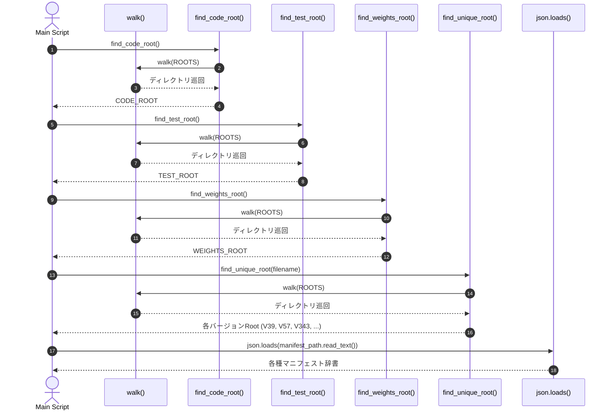

---

## 2. (cell 2: line 134〜164) 依存関係 (zarr) のオフライン導入
入力データ(zarr)の読み込み準備(zarr操作ライブラリのインストールとか)。

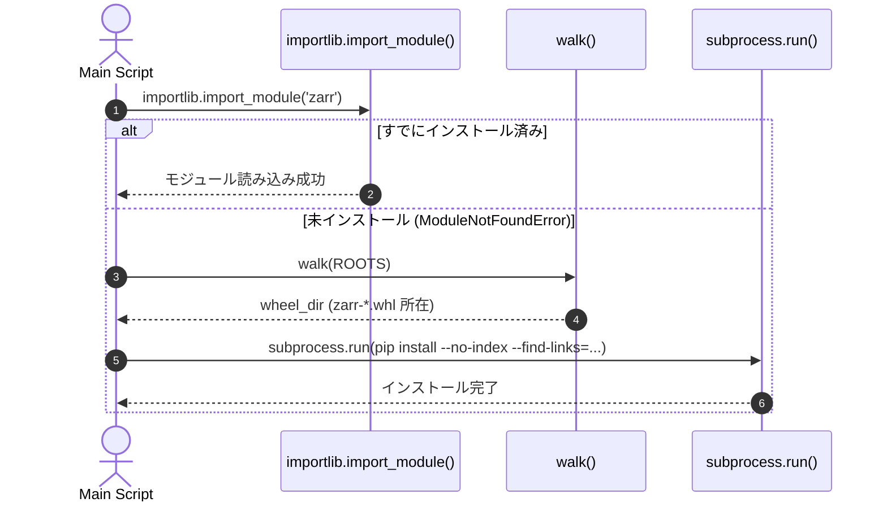

---

## 3. (cell 3: line 165〜185) 環境記録とデバイス選定
実行環境のチェックとか(GPU載ってないならエラーにしてる)。

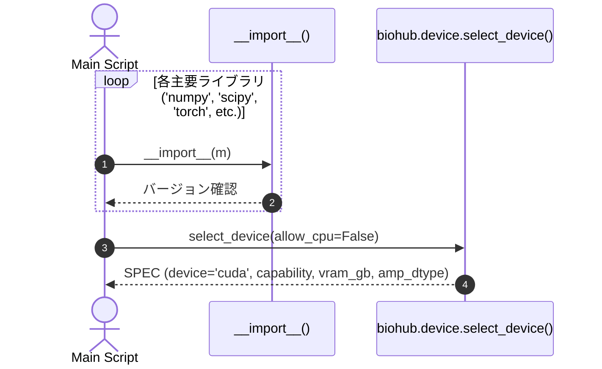

---

## 4. (cell 4: line 186〜535) モデルアンサンブルのロードと検証
cell 4 では、30 個以上 のモデルを同時にロードしてアンサンブルを構築する。

- このセルで実際にロードしている「アンサンブル」の内訳
  - **主幹検出器チーム(10個)**: 
    データを 5 分割して学習させた 5 人のモデル (fold0 〜 fold4) × 2 世代分 (V21 と V24) = 計 10 個
  - **強力な専門検出器チーム(5個)**:
    別の設定で極限まで鍛えた Stage-6 強力モデル 5 個
  - **長時間の動きを見るチーム(5個)**:
    5 フレームの時系列を捉える V39 モデル 5 個
  - **決定木・トラッカーチーム(数十個)**:
    細胞同士を繋ぐか判定する LightGBM のツリー群 (BoosterEnsemble)

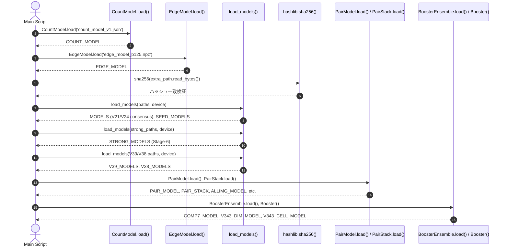

---

## 5. (cell 5: line 541〜669) 処理A: ボリューム取得・細胞検出

- **volumes_from_zarr()** ...処理の一番最初で、ロバスト正規化、等方化ダウンサンプリング(1, 4, 4)、float16 化を実施。
  (このコンペはz,y,xで[1.625μm, 0.40625μm, 0.40625μm]の解像度の違いがある)。
- **image_quantiles()** ... Dataset毎の統計情報::四分位数を取得している。取得したデータは、予測見積もりnode数に使用している。
- **v394.acquisition_cluster()** ... "acq_00:通常コントラストの標準的な撮影群" or "acq_01:低コントラスト・暗めの撮影群"を判別している。
- **detect_original_and_rotation()** ... メインの細胞検出器(V21モデル群)を実行する際に、「通常画像」と「180度回転させた画像（TTA）」の2通りで推論を行い、2種類の候補テーブルを同時に生成する関数。

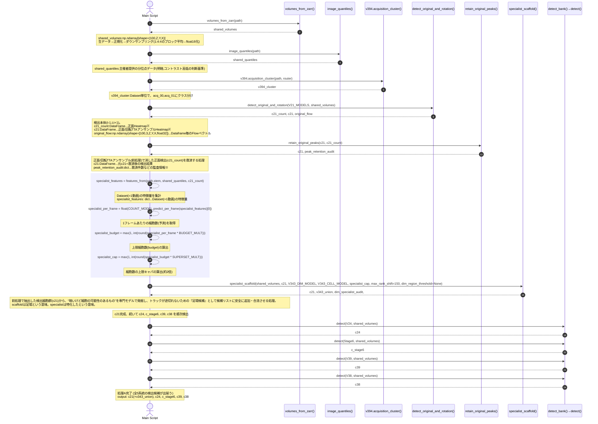

### ※c21_count:DataFrame(正面Heatmap)、c21:DataFrame(正面/回転TTAアンサンブルHeatmap)の列説明
|No|列名|説明|
|---|---|---|
|1|t|フレーム番号|
|2,3,4|z,y,x|検出中心座標(voxel)|
|5|score|検出信頼度(Heatmapピーク値)|
|6|rank_in_frame|同フレーム内scoreの順位|
|7,8,9|flow_z,y,x|次フレームへの移動量(Flow予測)|
|10|flow_sigma_um|当該Flow誤差の標準偏差σ[μm]（大:自信なし,小:自信あり）|
|11|near_um|最も近い近傍細胞までの距離(μm)|
|12|density_10um|半径10μm以内の局所細胞密度|
|13|peek_with_um|Heatmapピーク幅(μm)|
|14|boundary_um|画像の境界までの距離(μm)|
|15|emb_0～emb_47|Cell Embedding特徴量(48次元)。ReID、tracking,細胞リンク判定に使用する特徴ベクトル|

### ※peak_retention_audit:dict...救済件数などの監査情報の列説明
|No|列名|説明|
|---|---|---|
|1|heat_rows|元々のx21行数|
|2|recovered_original_rows|救済した行数|
|3|rows|最終行数|
|4|heat_fields_preserved|c21情報が改変されてないことの確認|
|5|original_fields_preserved|c21_count情報が改変されてないことの確認|
|6|maximum_frame_rows|frame毎の最大検出数|

### ※specialist_features: dict...Dataset(=1動画)分の特徴量のキー説明
NMS ... Non-Maximum Suppression(非極大値抑制)。密集した重複予測の中から「最もスコアが高い代表点だけを残し、周囲の重複した候補を間引く」 アルゴリズム。
|No|列名|説明|
|---|---|---|
|1,2|dataset, embryo|メタデータ|
|3,4,5|nms3.5_per_frame, nms5.0_per_frame, nms7.0_per_frame|NMS後候補数/フレーム|
|6,7,8|nms3.5_strong_per_frame, nms5.0_strong_per_frame, nms7.0_strong_per_frame|NMS後高スコア候補数/フレーム|
|9|pool_per_frame|全候補数/フレーム|
|10,11,12,13|score_p10, score_p50, score_p90, score_p99|スコア分位点|
|14,15,12,17,18,19,20,21|imq_0.0, imq_0.001, imq_0.01, imq_0.1, imq_0.9, imq_0.99, imq_0.999, imq_1.0|画像分位点統計量|
|22|n_frames|フレーム数|

### 5.1 v394.acquisition_cluster()のシーケンス

- メタデータ抽出（ステップ 1〜5）: 生ボリューム全体をスキャンせずに、Zarr の属性メタデータ（.attrs）から寸法・解像度スケール・パーセンタイル輝度を読み込む。
- 特徴量作成（ステップ 6）: コントラスト比やダイナミックレンジなど、撮影条件を特徴づける数値を計算して辞書にまとめます。
- 標準化（ステップ 7〜11）: 学習時に保存された平均・標準偏差(scaler_mean, scaler_scale)を使って標準化する。
- 最近傍分類（ステップ 12〜14）: あらかじめ学習・決定されている 2 つのクラスタ中心(canonical_centers)との距離を測り、近い方のインデックス(0 または 1)を選ぶ。
- 返却（ステップ 15〜16）: "acq_00" または "acq_01" の文字列として呼び出し元へ戻します。この情報は、後段の4つの後処理フェーズで使用される。

#### &emsp;&emsp; **あらかじめ学習・決定されている 2 つのクラスタ中心(canonical_centers)** とは ... 
&emsp;&emsp;&emsp;[右記](https://www.kaggle.com/competitions/biohub-cell-tracking-during-development/writeups/2nd-place-solution)に記載があり。``I grouped movies by image measurements, including brightness and contrast, using standardized features and K-means clustering.``
&emsp;&emsp;GTデータは使わず、trainデータから20特徴量を抜き出して、教師なし学習の「K-means クラスタリング（k=2）」で生成したもの。
&emsp;&emsp;trainデータ(3D動画輝度情報)を使わなかったのは、「情報量が多すぎる」のとDataset毎のコントラストや輝度情報などの 「撮影環境(カメラの写り具合)の違い」を学習させたかったためと思われ。
&emsp;&emsp;もし、trainデータを直接使用すると、「この動画は細胞が左にある」「こっちは右にある」という 細胞の位置のズレばかり を見てしまいかねない。
&emsp;&emsp;K-means によって求まった 2つのグループの重心(中心点)を、そのまま canonical_centers として .npz ファイルに保存している。

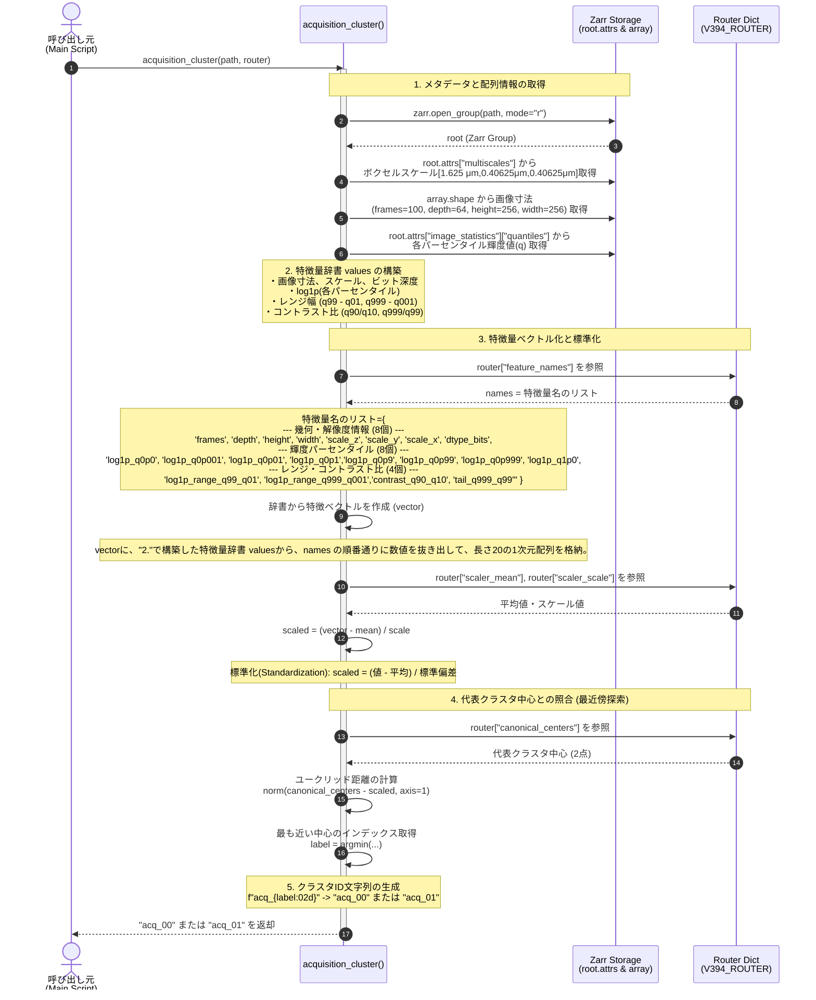

### 5.2 detect_original_and_rotation()のシーケンス
&emsp;&emsp;・引数1 models: fold0.ep05.pt ～ fold4.ep05.pt
    &emsp;&emsp;&emsp;&emsp;・ **fold[0-4].ep05.pt** ... input:前後3フレームの3D画像、output:1.中心ヒートマップ(heatmap)、2.サブボクセル・オフセット(offset)、3.後退運動ベクトルと
    &emsp;&emsp;&emsp;&emsp;&emsp;不確実性(flow, flow_logvar)、4.画像特徴記述子(features)のモデル。一言で言うと、「前後3フレームの立体画像を入力として受け取り、細胞の中心位
    &emsp;&emsp;&emsp;&emsp;&emsp;置・サブピクセル補正量・前フレームからの移動量・細胞の特徴ベクトルを一括予測する、弱シグナル細胞に強い3D U-Net 検出器」 を、5分割交差検
    &emsp;&emsp;&emsp;&emsp;&emsp;証（5-Fold）で学習させている。
    &emsp;&emsp;&emsp;&emsp;&emsp;&emsp;出力1.**中心ヒートマップ(heatmap)** ... 細胞の中心が存在する確率(0〜1）
    &emsp;&emsp;&emsp;&emsp;&emsp;&emsp;出力2.**サブボクセル・オフセット(offset)** ... 粗いグリッド(1.625μm)の中での微小な位置ズレ量($\Delta z, \Delta y, \Delta x$)。元の高解像度座標に復元するために使用。
    &emsp;&emsp;&emsp;&emsp;&emsp;&emsp;出力3.**後退運動ベクトルと不確実性(flow, flow_logvar)** ... 当該細胞が「前フレーム($t-1$)でどこから動いてきたか」という移動ベクトル(オプティカルフロー)と、
    &emsp;&emsp;&emsp;&emsp;&emsp;&emsp;&emsp;&emsp;&emsp;その予測の自信のなさ(分散)
    &emsp;&emsp;&emsp;&emsp;&emsp;&emsp;出力4.**画像特徴記述子(features)** ... 細胞の見た目の特徴を表す埋め込みベクトル。フレーム間で「同じ細胞同士」を結びつける照合に使用。
&emsp;&emsp;・引数2 vols: shared_volumes ... zarrの本体。形状:(T, Z, Y, X) = (100, 64, 64, 64)float16型。すでに「正規化」と「等方化ダウンサンプリング(1.625 μm 立方体グリッド)」済。
&emsp;&emsp;・引数3 device: SPEC.device ... torch.device("cuda")。要はGPU指定。
&emsp;&emsp;・引数4 amp_dtype: SPEC.amp_dtype ... torch.float16。
&emsp;&emsp;・引数5 batch: バッチサイズ(整数値 8)。100フレームある動画を、「1回に8フレームずつまとめて」GPU に送って推論する。
&emsp;&emsp;・引数6 return_flow=True: 真偽値フラグ。モデルが出力する 「細胞の移動ベクトル(flow: 前フレームへの動きの向きと大きさ)」を戻り値に含めるかどうか。True に設定することで、
&emsp;&emsp;&emsp;関数の3番目の戻り値として original_flowを受け取る。このベクトルは、後段で「途切れた細胞の軌跡を繋ぐ(Gap closure)」際に、細胞がどこから移動してきたかを辿るために再利用する。

- 時系列スタックの作成（ステップ2〜3）:
指定したバッチの時刻 ts に対して、前後1フレームを含む時系列ボリューム（3フレーム分）を GPU に転送、入力テンソル x を構築。
- 通常推論と回転推論の累積加算（ステップ4〜12）:
同じバッチ x に対して、通常画像と 180度回転画像(torch.flip)の両方をモデルに入力。
得られた出力から、通常ヒートマップ(heat)、元画像と回転画像をTTA平均化したヒートマップ(rotated_heat)、移動ベクトル(flow)、不確実性(flow_logvar)、サブボクセルオフセット(offset)、および細胞識別特徴量(features)をそれぞれ取り出してモデル間で累積加算(+=)。
- モデルアンサンブルの平均化(ステップ 13〜18):
累積加算した各テンソルをモデル数 $k$ で除算し、モデル間のアンサンブル平均値を算出。
- 2系統の候補テーブル化(ステップ 19〜28):
zip(rows, (heat, rotated_heat)) により _append_rows() を2回呼び出す。
内部ではピーク検出・座標補正・細胞識別特徴量(48次元)のサンプリング等(ステップ 20〜25)を行い、通常ヒートマップ由来の候補(c21_count 相当: ステップ 26)と、回転TTAヒートマップ由来の候補(c21 相当: ステップ 27〜28)の2系統の DataFrame を同時に生成する。
- 一括返却(ステップ 29):
c21_count、c21、および途切れた軌跡の接続に使う運動ベクトル original_flow の3点をまとめて呼び出し元に返却。

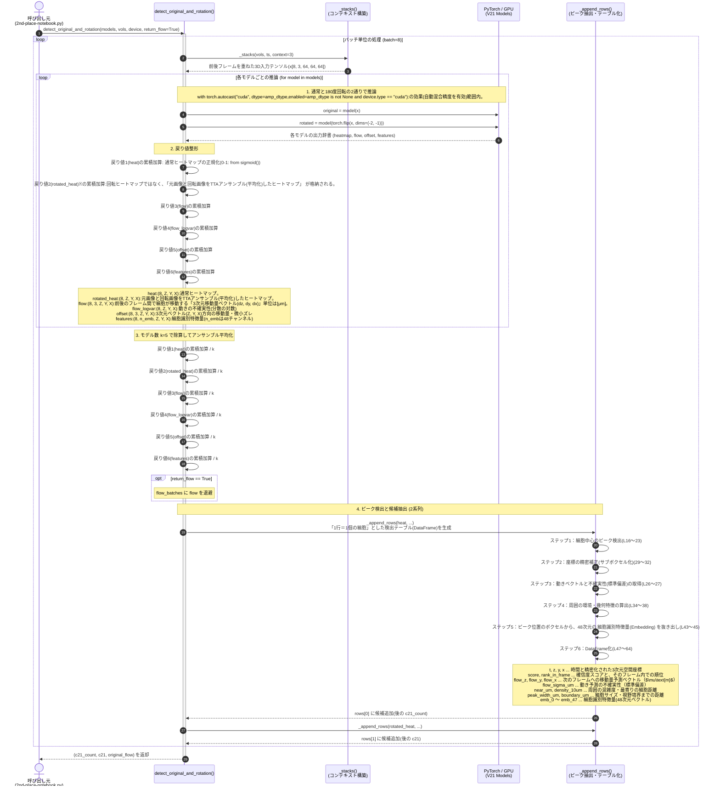

※**sigmoid** ... シグモイド関数(活性化関数)は、勾配消失問題があるが、それは学習時かつ中間層で使用する時に表面化する。今回は推論時かつ最終層で使用するだけなので勾配計算が発生せず問題ない。
※**戻り値2(rotated_heat)の算出** ...
  &emsp;・probability = 0.5 * (torch.sigmoid(original["heatmap"].float()) + torch.flip(torch.sigmoid(rotated["heatmap"].float()), dims=(-2, -1)))
  &emsp;&emsp;→ 元画像と回転画像をシグモイド化 → TTAアンサンブル(平均化)する。
  &emsp;・averaged_logit = torch.logit(probability.clamp(1e-6, 1.-1e-6))
  &emsp;&emsp;→ 確率($0 \sim 1$)を、元のモデル出力と同じ形式である Logit(未正規化スコア：$-\infty \sim +\infty$)に逆変換。Logit(ロジット)関数は、シグモイド関数の逆関数で、数式は以下の通り：
    $$\text{logit}(p) = \log\left(\frac{p}{1 - p}\right)$$
  &emsp;&emsp;もし確率 $p$ が完全に 0.0 や 1.0 になると：
  &emsp;&emsp;&emsp;$p = 0 \implies \log(0) \to -\infty$
  &emsp;&emsp;&emsp;$p = 1 \implies \frac{1}{0} \to +\infty$（ゼロ除算）
  &emsp;&emsp;となり、オーバーフローや数値計算エラー(NaN や Inf)が発生するため、確率値を $0.000001 \sim 0.999999$ の範囲に強制的に収める(クリッピングする)処理をしている。
  &emsp;・rh = torch.sigmoid(averaged_logit[:, 0].float()).cpu().numpy()
  &emsp;&emsp;→ averaged_logitをシグモイド化。sigmoid化 → logitで戻し → またsigmoid化してこの流れは無駄になってる。

### 5.3 retain_original_peaks()のシーケンス
**概要**: TTA平均化で取りこぼしてしまった細胞を、元画像の候補から3次元空間上で探し出して“救済・合流”させる。3次元の空間幾何計算(KD-Tree)や重複排除(NMS)を使用。

**引数**:
| **引数名** | **データ型** | **中身（中身の正体）** | 
|---|---|---|
| c21 | DataFrame | 「TTA回転アンサンブル」で平均化したヒートマップから検出した細胞候補テーブル(ノイズが少なしメインとなるベース) | 
| c21_count | DataFrame | 「元画像単体(TTAなし)」のヒートマップから検出した細胞候補テーブル(TTAで消えてしまった細胞をここから探して救済する) | 

**処理概要**:
- 空き枠の確認(ステップ 4): 1フレームあたりの上限枠(デフォルト3000件)に対して、TTA版(c21)の検出数に余裕があるか確認します。
- KD-Tree による重複判定(ステップ 5〜8): 元画像側(c21_count)の候補のうち、TTA側の既存細胞から $3.0\ \mu\text{m}$ より離れているものだけ を「見逃し細胞」として抽出します。
- NMS 間引き(ステップ 9〜11): 救済候補同士が近すぎる場合に共倒れしないよう NMS をかけ、空き枠数(slots)の分だけスコア上位を採用します。
- コンテキスト再計算(ステップ 14〜16): 細胞が追加されて周囲の配置が変わるため、最寄り細胞距離(near_um)や混雑度(density_10um)を再計算して整合性を保ちます。
- 返却(ステップ 20): 合成・救済された最終テーブル(result $\to$ 次の c21)と、何件救済されたかを記録した監査辞書(peak_retention_audit)を返します。

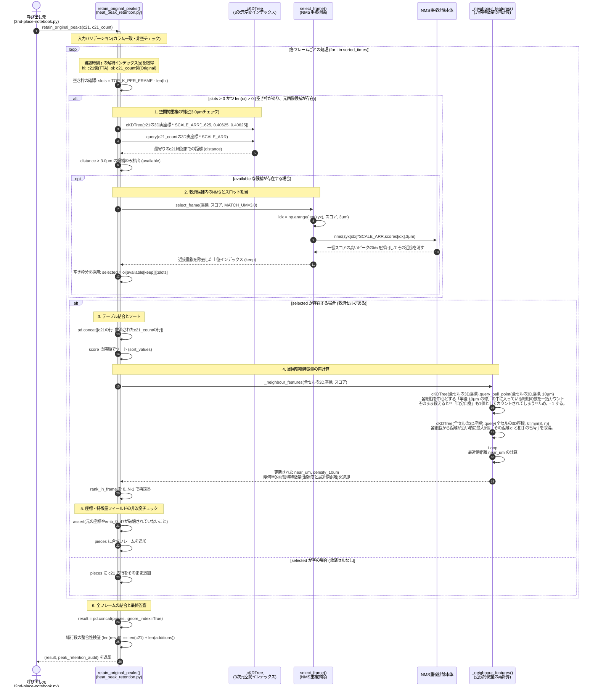

- **配列とスカラーの比較(NumPyのブロードキャスト)** ... NumPyは、1次元配列とスカラーを == で比較すると、ブロードキャスト機能によって配列の全要素に対してスカラー t との一致判定が自動的に行われます。
    ```python
    heat_times = np.array([0, 0, 1, 2, 1])
    t = 1  # スカラー値
    print(heat_times == t)
    # 出力: array([False, False, True, False, True])
    ```

### 5.4 specialist_scaffold()でやっていること
**概要**: c21(検出済全細胞群)の低スコア候補から、“暗いけど細胞として確か”を専用モデルで発掘(救済)し、トラックが途切れないための『足場候補』として候補リストに安全に追加・合流させる。
※専用モデルの作り方は、v343_models\full.json にレシピあり。

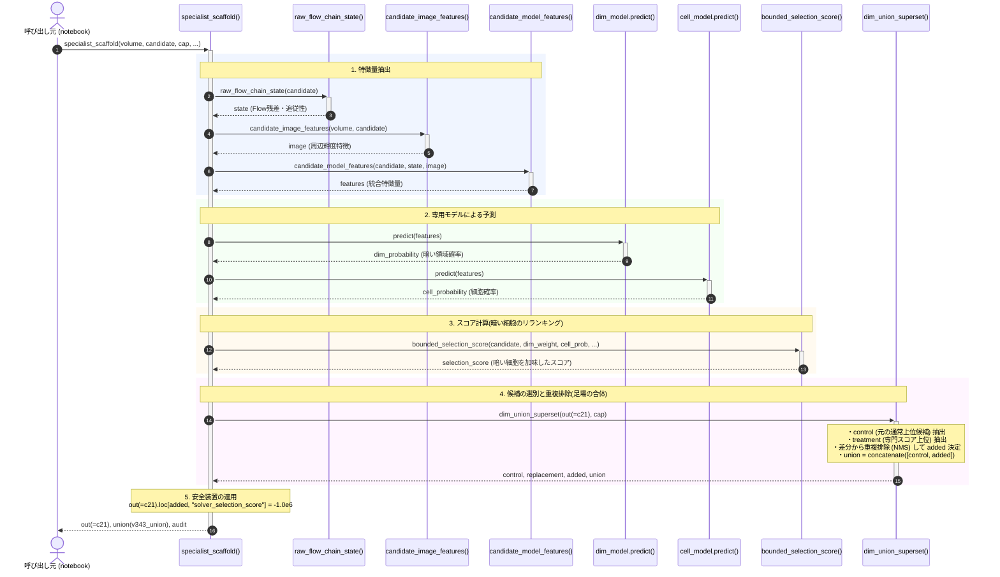


**処理概要**:
- ① 画像と時系列の局所特徴を抽出
    各候補点について、3Dボリューム画像から「局所的な明るさ・コントラスト」を取得し、さらに前後のフレームの動きベクトル(Flow)から「前後の点とどの程度きれいに追従しているか(残差)」を計算します。

- ② 2つの専用LightGBMで評価
    V343_DIM_MODEL: 「ここは暗い細胞が存在しやすい領域か？」を判定。
    V343_CELL_MODEL: 「ノイズではなく本物の細胞らしい特徴を持っているか？」を判定。

- ③ 通常の候補と「暗い細胞」を合体（Union）
    c21はそのまま、専用モデルによって高く評価された「暗い細胞候補」の中から、既存候補と被っていない(一定距離以上離れている)ものを追加候補(Added)として抽出→候補プール(v343_union)に追加。

- ④ 安全策：追加ノードのスコアを「-100万点」にする
``out.loc[added, "solver_selection_score"] = np.float32(-1.0e6)``
初期スコアをあえて極小値(-1.0e6)に設定。単体ではスコアが極小なので、存在するだけとなり採用されない(ノイズによる過剰検出ペナルティを防ぐ)。後段のトラッキングソルバー(Solver)で「前後のフレームの確実な細胞と強いエッジで繋がっている」と確認された場合のみ、前後のサポート(接続ボーナス点)を受けてトラックの欠損を埋めるため、足場候補から採用される。

- まとめ
specialist_scaffold() は、 「暗い細胞を、専用モデルでトラックが途切れるのを防ぐ中継ノード(Scaffold)を発掘し、過剰検出リスクをゼロに抑えた状態で後段のトラッカーに託す処理」 を実行する。


### 5.5 c21, c24, c_stage6, c39, c38の検出モデルの違い
この4つのモデル群は、それぞれ **「入力する時間幅」「学習方針」「後段のグラフ統合（アンサンブル）での役割」** が異なる。

|No| モデル | 時間窓 | 特徴 | 主なミッション |
|---| :--- | :---: | :--- | :--- |
|1| c21(基準) | 3フレーム | 基準となる基本検出器 | 全体のベースグラフを作る |
|2| c24 | 3フレーム | V21の別系統モデル | V21が見落としたトラックの補完 |
|3| c_stage6| 3フレーム | 高精度・強検出器 | V24との合意（Consensus）で確実なエッジを形成 |
|4| c39 | 5フレーム| 広い時間視野を持つモデル | リスク判定に基づく高品質トラックへの「入れ替え」 |
|5| c38 | 5フレーム| 5フレームの残差モデル | 最終的な残差補完 ＆ 細胞分裂の多数決投票 |


### 1. c21(基準)
細胞検出のベース。

### 2. c24(`V24_MODELS`)
* **何のモデルか**:
  主軸のc21と同じ構造を持つ **3フレーム入力（$t-1, t, t+1$）の 3D Temporal U-Net**（5-fold CV モデル）。
* **どういう学習をさせたか**:
  c21とはデータ拡張、サンプリング条件、または損失関数のバランスを少し変えて訓練された別バリエーション別系統）のモデル。
* **狙い(役割)**:
  - **「見落としの補完」**: V21が検出できなかった完全な細胞の軌跡（full-length track）を、後から安全に追加合成（`add_full_length_segments`）するため。
  - **「多様性の確保」**: 同じ3フレームモデルでも、V21と微妙に異なる予測を出させることで、アンサンブルの基礎を生成。

### 3. c_stage6(`STRONG_MODELS`)
* **何のモデルか**:
  単体性能を極限まで高めた **「強検出器（Strong Detector）」**（5-fold CV モデル）。
* **どういう学習をさせたか**:
  バックボーン設定や最適化された学習スケジュールで、検出ミスや位置ズレ（偽陽性・偽陰性）を極小化するように学習した高精度モデル。
* **狙い(役割)**:
  - 「高信頼なエッジの合意(Consensus)」: 後段で `add_stage6_v24_consensus_edges` という処理を行い、**「V24とStage6の両方が『この細胞同士は繋がっている』と合意した確実なエッジだけを採用する」** というジャッジに使用する。

### 3. c39(`V39_MODELS[route]`)
* **何のモデルか**:
  通常の3フレームではなく、5フレーム（$t-2, t-1, t, t+1, t+2$）を同時に入力する広域時系列 3D U-Net。
* **どういう学習をさせたか**:
  時間窓を前後に広げ、急激な移動や長い時間軸での細胞の連続性を捉えられるように5フレームを入力チャネルとして学習。
* **狙い（役割）**:
  - 「カウント中立な軌跡の入れ替え(Exchange / Recovery)」: 5フレームの広い視野を持つV39が作ったトラックと、既存のトラックを比較します。
  - 機械学習モデル（`V57_BOOSTERS`）でリスクを判定し、「既存のトラックよりもc39のトラックの方が確からしい」と判断された部分を、細胞の総数を増やさずに（ペナルティを避けつつ)高品質なトラックへと差し替えるために使用。

### 4. c38 (`V38_MODELS[route]`)
* **何のモデルか**:
  V39と同様に 5フレーム入力(`in_frames == 5`) を持つ、残差(Residual)補完用の時系列検出器。
* **どういう学習をさせたか**:
  V39とは異なるシード値や学習設定で訓練された、もう一つの5フレーム時系列モデルです。
* **狙い（役割）**:
  - **「最後の取りこぼし回収」**: V39の入れ替えを行ってもなお残った欠損部分に対し、最終段で残差トラックを追加合成（`add_full_length_segments`）する。
  - **「細胞分裂（Division）の多数決投票」**: 直後の処理で、細胞が2つに分裂するポイントを **4者合議（V24, Stage6, V39, V38 の投票 `fork_votes`）** で決定する際の投票役(Witness)。

---

## 6. (cell 5: line 670〜694) 処理B: 5系統の並列追跡 (トラッキング)

出揃った5つの細胞検出候補テーブル（`c21, c24, c_stage6, c39, c38`）を入力とし、`ThreadPoolExecutor`（3ワーカー）を用いて各モデル系統のトラッキング処理（`run_chain`）をCPUで並列実行する。
各系統で時系列エッジ確率の計算とソルバー最適化（`track_dataset_learned_v8`）を行い、5つの独立した細胞移動軌跡グラフ（`v21.graph, v24.graph, stage6.graph, v39.graph, v38.graph`）を生成・回収する。

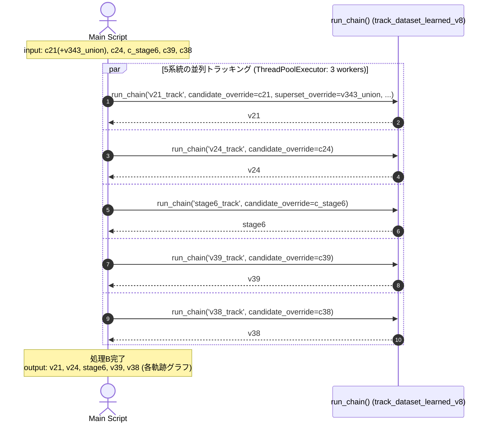

### 戻り値(メンバ構造とサイズ(次元))
このフェーズ(処理B)では、アンサンブルは行っていない。アンサンブルの元となるデータを生成している。

`v21`, `v24`, `stage6`, `v39`, `v38` ... NumPy配列やテンソルではなく、トラッキング結果を保持する Python のデータクラス(dataclass)オブジェクト。
- v21_track    ──> v21.graph （全体の基準ベース）
- v24_track    ──> v24.graph （取りこぼし補完用）
- stage6_track ──> stage6.graph （高信頼な強モデル）
- v39_track    ──> v39.graph （5フレーム広域モデル）
- v38_track    ──> v38.graph （5フレーム残差モデル）

#### 6.1. 型（Type）

* **型名**: **`biohub.pipeline.learned.TrackResult`**
  （追跡処理 `track_dataset_learned_v8` の実行結果オブジェクト）

#### 6.2. 内部のデータ構造（Attributes）
メンバ一覧

| 属性名 | 型 | 説明 |
| :--- | :--- | :--- |
| **`.graph`** | **`DatasetGraph`** | **追跡結果の本体（細胞ノードとエッジのグラフ）** |
| `.n_candidates` | `int` | 元の候補点の総数（例: 数万〜数十万点） |
| `.budget_per_frame`| `int` | 1フレームあたりに採択した目標細胞数（`budget`） |
| `.predicted_per_frame`| `float` | モデルが予測した1フレームあたりの平均細胞数 |
| `.n_selected` | `int` | 最終的にグラフに採択された細胞ノードの総数 |
| `.n_forks` | `int` | 検出された細胞分裂（1親→2子への分岐）の個数 |
| `.n_edgeless` | `int` | 前後と繋がらなかった孤立ノードの個数 |

直後の処理（`add_full_length_segments(v21.graph, v24.graph)` など）では、この中の **`.graph`** が使用される。

#### 6.3. 主データである `.graph`（`DatasetGraph`）の構造と Shape（サイズ）

`.graph` は **`biohub.io.submission.DatasetGraph`** 型で、以下の3つの主要データを持つ。

##### ① `graph.nodes`（細胞の位置情報）
* **型**: `dict[int, tuple[int, int, int, int]]`
* **構造**: `{ノードID: (t, z, y, x)}`
* **実質的な Shape**: **`(N, 4)`**（$N$ は採択された細胞の総数）
  - $N$ の規模：通常 1動画あたり数千〜数万個程度
  - 4次元の内訳：`t`（フレーム番号: 0〜99）, `z`（深度: 0〜63）, `y`（高さ: 0〜63）, `x`（幅: 0〜63）

##### ② `graph.edges`（細胞同士の繋がり・軌跡）
* **型**: `list[tuple[int, int, float]]`
* **構造**: `[(親ノードID, 子ノードID, 信頼度スコア), ...]`
* **実質的な Shape**: **`(E, 3)`**（$E$ は結ばれたエッジの総数）
  - $E$ の規模：ほとんどの細胞が前後のフレームと1対1で繋がるため、$E \approx N$（数千〜数万本）

##### ③ `graph.shape`（ボリューム寸法）
* **型**: `tuple[int, int, int, int]`
* **値**: **`(T, Z, Y, X)`**（例: `(100, 64, 64, 64)`）
  - 画像領域のバウンダリチェック（枠外はみ出し防止）に使用。

---

## 7. (cell 5: line 695〜789) 処理C: グラフ統合・コンセンサス・ギャップ補完

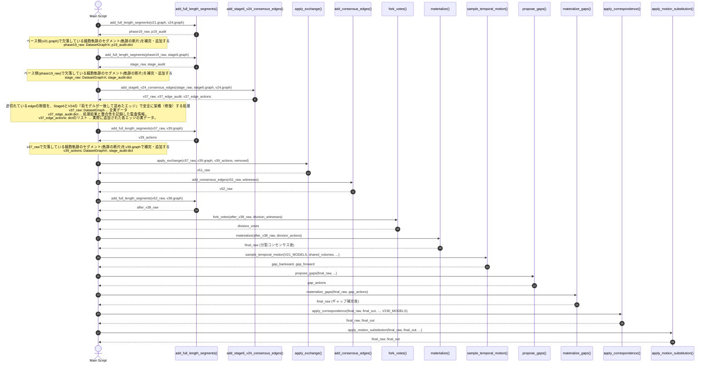

### ※DatasetGraph型(biohub.io.submission.DatasetGraph)
このコンペ主催者が提供してくれてるソースコードの中で使用する型。

**メンバ**:
- **phase19_raw.shape**: tuple[int, int, int, int]=[100,64,256,256]
    - データセットの時空間ボリュームサイズ (T, Z, Y, X)
- **phase19_raw.nodes**: dict[int, tuple[int, int, int, int]]
    - キー: ノードID(int)
    - 値: 各ノードの時空間座標 (t, z, y, x)
    - ノード数は len(phase19_raw.nodes) (ベースのノード数 + 今回追加されたノード数)
- **phase19_raw.edges**: list[tuple[int, int, float]]
    - (source_id, target_id, confidence) ... edgeリスト
    - エッジ数は len(phase19_raw.edges) (ベースのエッジ数 + 今回追加されたエッジ数)
- **phase19_raw.dataset**: str
  - データセット識別子 ... ``44b6_0113de3b``とか

### ※p19_audit(,stage_audit)の型: dict
追加処理の結果と整合性を記録した 9つのキーを持つ監査情報辞書

**メンバ**:
- ``dataset``: str ... データセット名(例:``44b6_0113de3b``)
- ``segments``: int ... 追加されたセグメントの総数
- ``bridges``: int ... 既存ノード間を繋いだブリッジ数
- ``tails``: int ... 末端から伸びたテイル数
- ``heads``: int ... 先頭前に遡るヘッド数
- ``added_nodes``: int ... 新規追加されたノード数
- ``added_edges``: int ... 新規追加されたエッジ数
- ``original_nodes_preserved``: bool (True)
- ``original_edges_preserved``: bool (True)
- ``division_forks_preserved``: bool (True)

### add_stage6_v24_consensus_edges()のシーケンス
このモデルの解法(2位解法)はアンサンブルをいろんな局面で使い込んでるところが特徴。
そしてアンサンブルは、使い方を間違うとスコアダウンになるので、正しい使い方を理解すべくこのシーケンスを追ってみた。
#### 1. 処理概要
既存のグラフ(stage_raw)のノードは一切増やさず、途切れてしまっている既存ノード同士の1フレームの隙間に対し、Stage-6 と V24 の両モデルが「ここは繋がっている」と一致（AND合意）したエッジ(線)だけを安全に追加する。

#### 2. 戻り値の型と shape

|No| 戻り値 | 型 | shape / 構造 | 内容 |
|---| :--- | :--- | :--- | :--- |
|1| **`v37_raw`** | `DatasetGraph` | 合意エッジが追加された新しいグラフ。<br>・`nodes`: `stage_raw.nodes` と同じ(ノードは不変)。<br>・`edges`: `stage_raw.edges + selected`。<br>・`shape`: `(100, 64, 256, 256)` |
|2| **`v37_edge_audit`** | `dict` | 処理結果と整合性を記録した監査情報。<br>・`'selected_edges'`: 追加されたエッジ数<br>・`'raw_agreed_edges'`: 両者合意した候補数<br>・`'original_nodes_preserved'`: `True` 等 |
|3| **`v37_edge_actions`** |リスト | 実際に追加された各エッジの実データ。<br>各要素: `{'dataset': str, 'source': int, 'target': int, 'source_t': int}` |

### 3. 直前で c24 と stage6 を追加したのに、なぜさらにアンサンブルしてるのか？

直前の2行とこの処理では、「追加している対象」と「目的」が全く異なるため。

#### (1) 直前の2行（`add_full_length_segments`）がやったこと
* 追加したもの: 「新しいノード」
* c24 と Stage-6 が細胞と認識した新ノードをグラフに追加した。

#### (2) この処理（`add_stage6_v24_consensus_edges`）がやること
* 追加するもの: ノード追加はしない。既存ノード間を繋ぐエッジのみを追加
* グラフ内のノード(stage_raw)は1個も追加しない。

#### (3) なぜこの順番で行うのか？
直前の2つのセグメント追加によって、グラフ空間上には
* c21 由来のノード
* c24 由来の追加ノード
* Stage-6 由来の追加ノード
が存在することになる。
その状態だと、「c21の軌跡の末端」と「Stage-6の先端」のように、異なるモデルが持ち寄ったnode同士が、時空間上で1フレームの隙間（Gap）を挟んで向かい合っている状態が起こりえる。

```text
[stage-6、c24ノード追加後]
c21のedge: (t=10) ●───● (t=11:末端) ???(隙間)
Stage6のedge:                                (t=12: 先端) ●───● (t=13)
[add_stage6_v24_consensus_edges 後]
両モデル合意:  (t=10) ●───● (t=11) ═══════════> (t=12) ●───● (t=13)
                                  ↑ 合意エッジで1本に結合！
```
上記の分断された隙間に対して、Stage-6 と V24 の両者に **「お前たち2人とも、ここが繋がっていると認めるか？」** と問い合わせ、2つのモデルが両方とも「繋がっている」と証言した箇所だけをエッジで架橋（Stitch）している。
これによって、バラバラだった軌跡の断片が1本のトラックへと統合することができるようになるため、このタイミングで実行する。

---

### 4. `add_stage6_v24_consensus_edges()` のシーケンス図

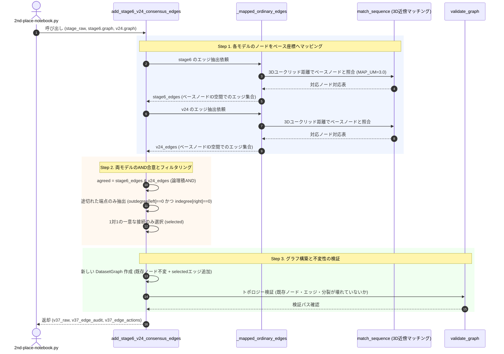

---

## 8. (cell 5: line 790〜887) 処理D: グラフ確定と多段プロテクター後処理

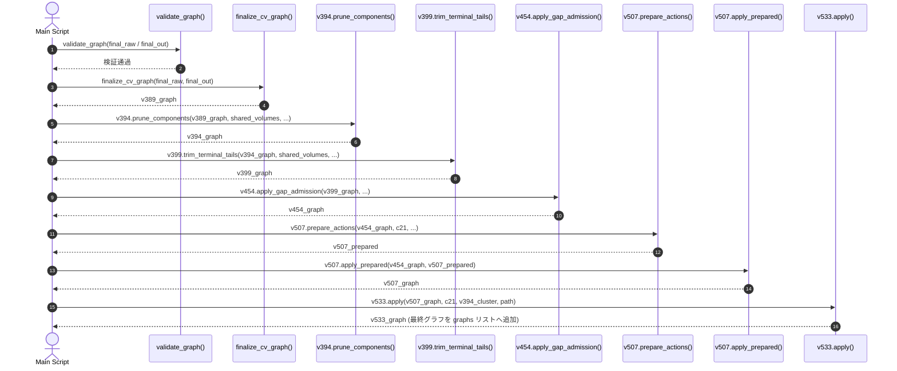

---

## 9. (cell 6: line 891〜911) サブミッションの検証・出力
submission.csvを生成する処理。大したことはやってない。

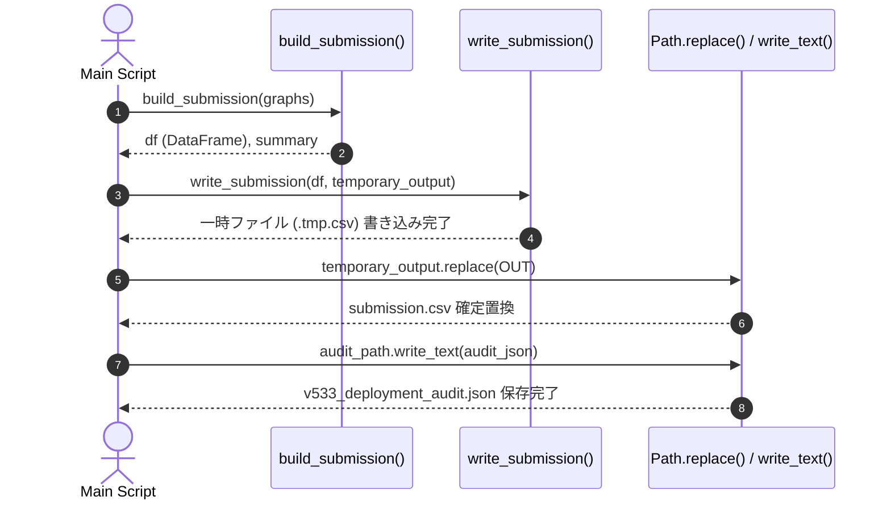
