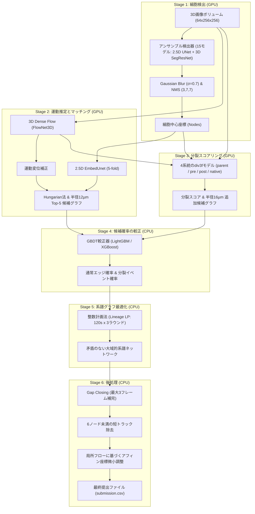

18-⑤Kaggle実践3 Biohub細胞トラッキング 3位解法のまとめ


## Abstract
- biohub 3位解法(yu4u / ren4yu、submission 060: Private 0.96918 / Public 0.97832)のまとめ
- 高精度な細胞検出アンサンブル(2.5D U-Net + 3D SegResNet)に実行時間の55%を投入
- 3Dデンスフローによる運動補正、4系統の分裂同定モデル(div3f)、そして整数計画法(Lineage LP)による大域的最適化とアフィン座標微小調整により、圧倒的な分裂検知精度(Division Jaccard 0.540)と高い追跡精度を両立した洗練されたパイプラインの完全解説

## 概要
先日、Biohub細胞トラッキングコンペが完了しました。
Private LB 1353位/3800人と大変悔しい結果に終わりましたが、Kaggleの素晴らしいところは、トップランカーたちの卓越した解法が惜しみなく公開されることです。
この学びの宝庫を徹底的に解析し、確実に自身のスキルへと昇華させるべく、今回は3位に入賞されたKaggle Grandmaster・内田氏(yu4u / ren4yu)の解法を深掘りします。

## biohub 3位の解法まとめ
3位の解法は、各ステージが極めて論理的かつ堅牢に設計されており、コンペ特有の「疎なアノテーション(全細胞の約2.8%)」と「極端に少ない分裂データ(全199動画でわずか151件)」という困難な課題に対して、王道かつ高度な機械学習・数理最適化技術を結集してアプローチしています。

- 解説のURL (Writeup)
https://www.kaggle.com/competitions/biohub-cell-tracking-during-development/writeups/3rd-place-solution
- ソースコード (Inference Notebook)
https://www.kaggle.com/code/ren4yu/biohub-inference-run

---

## プロジェクト構成

3位解法は、推論パッケージ本体(`biohub-inference`)と、学習済み重み群(`biohub-weights`)の2つのデータセットから構成されています。

```text
3rdPlaceSolution/
├── biohub-inference/                  # 推論パッケージ本体
│   ├── biohub_infer/
│   │   ├── __main__.py                # CLIエントリーポイント(検証、ワーカー起動、CSV出力)
│   │   ├── config.py                  # パイプライン定数、モデル構成、重みファイルマッピング
│   │   ├── trt.py                     # TensorRT 共有メモリランナー(TrtModel, TrtIO)
│   │   ├── core/                      # 共通モジュール
│   │   │   ├── model.py               # EmbedUnet(2.5D Siamese Matcher)
│   │   │   ├── dataset.py             # Zarrアクセス、CellStore、統計正規化
│   │   │   ├── matcher.py             # ノード間類似度スコアリング
│   │   │   ├── metric_event_optimizer.py # 整数計画法(Lineage LP)ソルバー本体
│   │   │   └── coordinate_refinement.py  # 座標アフィン微小調整
│   │   ├── infer/                     # GPU処理ステージ
│   │   │   ├── clip.py                # 動画単位の推論ドライバー(検出・マッチング・分裂)
│   │   │   ├── common.py              # TTA、ガウシアンブラー、ピーク検出、モデル読み込み
│   │   │   ├── linking.py             # Hungarian法、マッチング候補グラフ構築
│   │   │   └── div797_parent*.py      # フローワープ済み画像からの親細胞分裂スコアリング
│   │   ├── lineage/                   # CPU処理ステージ
│   │   │   ├── build.py               # 線形計画法・後処理ドライバー
│   │   │   ├── div846_lineage.py      # GBDT較正予測とLP制約生成
│   │   │   ├── gap_close.py           # 最大3フレームのギャップ補完
│   │   │   └── affine_refinement.py   # フロー場に基づく座標微調整
│   │   └── ssl_flow/                  # 3D Dense Flow (FlowNet3D)
│   └── wheels/                        # オフラインインストール用ホイール群
├── biohub-weights/                    # 学習済み重みファイル一式 (全70ファイル)
│   ├── dl_284_fold0~4_last.engine     # 検出器1: EfficientNetV2-L 2.5D U-Net (5-fold, TRT)
│   ├── dl_275_fold0~4_last.engine     # 検出器2: 3D SegResNet (5-fold, TRT)
│   ├── dl_492_fold0~4_last.engine     # 検出器3: EfficientNet-B7 2.5D U-Net (5-fold, TRT)
│   ├── dl_401_fold0~4_last.ckpt       # マッチャー: 2.5D EmbedUnet (5-fold, PyTorch)
│   ├── ssl_flow_flow_164_ep48.pt      # デンスフロー: FlowNet3D (PyTorch)
│   ├── div_415_*.engine               # 分裂親細胞モデル (parent, 5-fold, TRT)
│   ├── div_478_pre_*.engine           # 分裂前モデル (pre, 5-fold, TRT)
│   ├── div_478_post_*.engine          # 分裂後モデル (post, 5-fold, TRT)
│   ├── div_762_*.engine               # 元解像度親細胞モデル (native-parent, 5-fold, TRT)
│   ├── model_fold-1.json              # 較正器: LightGBM / XGBoost モデル定義
│   ├── native.txt / wide.txt          # GBDTツリー重みファイル
│   └── md5sums.txt                    # 重みチェックサム検証ファイル
├── biohub-inference-run.ipynb         # Kaggle / ローカル両対応推論ノートブック
├── biohub_inference_run.py            # 推論実行Pythonスクリプト
└── requirements.txt                   # 仮想環境再現用ファイル
```

### 主要モデル・重み一覧

| カテゴリ | モデル名・ファイル | アーキテクチャ / 規模 | 役割・機能 |
| :--- | :--- | :--- | :--- |
| **Detection (検出)** | `dl_284` (5-fold)<br>`dl_275` (5-fold)<br>`dl_492` (5-fold) | EfficientNetV2-L 2.5D U-Net (重み0.3)<br>3D SegResNet (重み0.3)<br>EfficientNet-B7 2.5D U-Net (重み0.4) | **細胞中心のヒートマップ検出:** 計15個のモデルアンサンブル。ガウシアンブラー(σ0.7)とNMS(3, 7, 7)で細胞中心ピークを抽出。実行時間の55%を占める最重要基盤。 |
| **Motion (運動)** | `ssl_flow_flow_164_ep48.pt` | 3D FlowNet (PyTorch) | **3Dデンスフロー推定:** 連続フレーム間の3次元ボクセル変位場を推定し、細胞の運動を補正。マッチングと画像アライメントの双方に再利用。 |
| **Matching (対応付け)** | `dl_401_fold0~4_last.ckpt` | 2.5D Siamese EmbedUnet (5-fold) | **細胞埋め込み特徴抽出:** フレーム内の各細胞位置から埋め込みベクトルを抽出し、時間方向の対応付け確率(ロジット平均)を算出。 |
| **Division (分裂判定)** | `div_415` (parent)<br>`div_478_pre` (pre)<br>`div_478_post` (post)<br>`div_762` (native) | div3f エンコーダ/デコーダ (各5-fold、計40 engines) | **4系統の分裂ステージ分類:** rot4 TTA(4方向回転)と時間ウィンドウ間でのエンコーダ特徴量再利用により高速推論。親細胞・分裂前・分裂後を高精度に識別。 |
| **Calibration (較正)** | `model_fold-1.json`<br>`native.txt` / `wide.txt` | LightGBM / XGBoost / Logistic Regression | **候補スコアの確率較正:** 距離、フロー補正距離、マッチング確率、分裂スコアなど多様な特徴量を統合し、通常リンク確率と分裂イベント確率へ変換。 |
| **Optimization (最適化)** | `lineage/div846_lineage.py` | 整数計画法(Lineage LP) / SciPy LP | **大域的系譜グラフ構築:** 生物学的制約(流入次数<=1、流出次数<=2等)を満たしながら、対数オッズ比の総和を最大化。3ラウンド(各120秒)で最適解を探索。 |
| **Refinement (座標補正)** | `lineage/affine_refinement.py` | 局所アフィン変換補正 | **オプティカルフローに基づく座標微調整:** 検出ノードおよびギャップ補間ノードの位置をフロー場に沿って物理的に洗練。 |

---

## 3位解法の全体像

3位解法は、直感的なヒューリスティクスだけに頼るのではなく、**「強力な検出」→「フロー補正付きマッチング」→「専門化された分裂判定」→「数理最適化(整数計画法)による大域的一括解決」**という極めて論理的な6段階パイプラインを構築しています。



---

## パイプラインの詳細解説

### 1. 細胞検出 (Cell Detection): 実行時間の55%を投入した最重要基盤
トラッキングの成否は「細胞が正しく検出されているか」に完全に依存します。検出漏れはトラッキングの途切れを生み、偽陽性は不正なエッジを誘発するため、作者は検出器のアンサンブルに最も大きな計算リソースを割り振りました。

* **3系統・計15個のモデルアンサンブル**:
  - `dl_284`: 2.5D U-Net (バックボーン: EfficientNetV2-L、重み 0.3)
  - `dl_275`: 3D SegResNet (重み 0.3)
  - `dl_492`: 2.5D U-Net (バックボーン: EfficientNet-B7、重み 0.4)
  - それぞれ5-foldのクロスバリデーションモデルを用意し、全15モデルの予測ヒートマップを重み付き平均。
* **ピーク検出処理**:
  - 平均ヒートマップに対してガウシアンブラー(σ = 0.7)を適用して微小ノイズを除去。
  - カーネルサイズ (3, 7, 7) の3D Max PoolingによるNMS(Non-Maximum Suppression)を実施。
  - 閾値 0.2 以上の極大点を細胞中心ノードとして抽出。
* **TensorRTによる高速化**:
  - すべての検出器をTensorRT fp16エンジン化し、2基のGPUで並列処理することで推論時間を大幅に短縮。

---

### 2. デンスフローと細胞マッチング (Dense Flow & Matching)
生物の細胞は組織全体の流動や自律的な移動を伴うため、単純なユークリッド距離だけでは誤った対応付けを起こします。

* **3Dデンスフロー (FlowNet3D)**:
  - 連続するフレーム $t \to t+1$ 間の全ボクセルの変位場 $(\Delta z, \Delta y, \Delta x)$ を推定。
  - 前フレームの細胞座標をフローベクトルで移動補正し、見かけの移動を大幅にキャンセル。
* **EmbedUnet による細胞特徴量抽出**:
  - 2.5D Siamese UNet構造により、各細胞の周囲領域から32次元の埋め込み特徴ベクトルを抽出。
  - 2つの細胞間のコサイン類似度・内積から対応付け確証度を計算。
* **候補グラフの生成**:
  - フロー補正後の距離ゲート(12 µm以内)を満たす上位候補を抽出。
  - 初期割り当てとしてのHungarian法、および近傍半径12 µm以内のTop-5候補エッジを構築。

---

### 3. 分裂同定 (Division Identification): 4系統の専門モデル
細胞分裂(1つの親細胞が2つの娘細胞に分裂するイベント)は、全データ中でごく稀にしか起きず、アノテーションも極めて不足しています(全199動画で151件のみ)。3位解法では、分裂を単一の分類器で解くのではなく、**4つの異なる時間的役割を持つモデル群**に分割して解きました。

1. **`parent` (親細胞モデル)**: 分裂直前の親細胞である確信度を判定(3フレーム入力)。
2. **`pre` (分裂前モデル)**: 分裂の兆候がある前段階の細胞を検知(3フレーム入力)。
3. **`post` (分裂後モデル)**: 分裂直後に出現した娘細胞のペアを識別(3フレーム入力)。
4. **`native_parent` (元解像度親モデル)**: ダウンサンプルを行わない高解像度ボリュームから直接親細胞を識別(5フレーム入力)。

* **特徴量再利用 (Feature Reuse)**:
  - 重複する時間ウィンドウ間でエンコーダ特徴量をキャッシュして再利用することで、計算負荷の高い40個のTensorRT分裂エンジンを極めて効率的に動作させています。
* **rot4 TTA**:
  - 4方向の90度回転TTA(Test-Time Augmentation)を適用し、細胞の分裂軸の方向に依存しない安定したスコアを獲得。

---

### 4. 候補スコアのGBDT較正 (Calibration)
ニューラルネットが出力する生スコアや距離メトリクスを、後続の整数計画法で直接比較可能な**確率値(Log-odds)**へと変換します。

* **特徴量エンジニアリング**:
  - 物理距離、フロー補正後距離
  - Matcher 双方向スコア、候補ランク、マージン
  - 検出ヒートマップの信頼度(Confidence)
  - 分裂モデル群の親スコア、preスコア、postスコア、および前後の先行細胞への伝播スコア
* **モデル構成**:
  - LightGBM、XGBoost、ロジスティック回帰を組み合わせ、通常エッジの接続確率 $P(\text{edge})$ と、分裂イベントの成立確率 $P(\text{div})$ を極めて正確に較正。

---

### 5. 系譜グラフ最適化 (Lineage Graph Optimization): 整数計画法(LP)による一括解決
局所的な貪欲法(Greedy)では、競合する接続や長期間の整合性を保てず、偽陽性の連鎖が起きます。3位解法では、すべての候補接続と分裂イベントを**整数計画問題(Integer Linear Programming)**として定式化し、グローバルに一括最適化しました。

* **目的関数**:
  $$\max \sum_{e \in E} w_e \cdot x_e + \sum_{d \in D} w_d \cdot y_d$$
  ここで $w_e = \log \frac{P(e)}{1 - P(e)} - \theta_{\text{edge}}$ はエッジの対数オッズ比、$w_d = \log \frac{P(d)}{1 - P(d)} - \theta_{\text{div}}$ は分裂イベントの対数オッズ比です。
* **生物学的整合性制約**:
  1. **流入次数の制限**: 各細胞に入ってくるエッジは高々1本(親は1つだけ)。
  2. **流出次数の制限**: 各細胞から出ていくエッジは、通常リンクなら高々1本、分裂するなら正確に2本の娘エッジ。
  3. **分裂の整合性**: 分裂イベント $y_d$ が採択された場合、親細胞からの通常エッジは禁止され、指定された2つの娘細胞へのリンクが強制される。
* **ソルバー実行**:
  - 120秒制限 x 3ラウンドの最適化ステップを実施し、実行可能解の中から最もスコアの高い細胞系譜ネットワークを決定。

---

### 6. 後処理 (Post-processing): スコアを極限まで押し上げる3つの仕上げ
最適化されたグラフに対して、コンペの評価指標(Adjusted Edge Jaccard & Division Jaccard)に最適化された3つの後処理を適用しました。

1. **A4: Gap Closing (最大3フレームのギャップ補完)**:
   - 一時的な検出漏れにより途切れたトラックの終点と始点を、オプティカルフロー補正とHungarian法で接続。
   - 欠落フレーム数 $g \in \{1, 2, 3\}$ に対し、距離ゲート $3 \times (g + 1)$ µm を適用し、中間に線形補間ノードを挿入。
2. **A5: 短い連結成分の除去 (Short component removal)**:
   - 全長が6ノード未満の極端に短い孤立トラックを除去(ノイズやゴミの排除)。
3. **A6 & A7: 座標のアフィン微小調整 (Affine Coordinate Refinement)**:
   - 検出されたノード座標(A6)および補間されたノード座標(A7)を、周囲の局所オプティカルフロー場の移動ベクトルに沿って微調整。
   - 正解座標とのアライメント誤差を物理レベルで最小化。

---

## アブレーションスタディ: 段階的進化の軌跡

著者らが199本の全トレーニング動画(OOF)で実施した、各ステージの追加・置き換えによるスコア向上の推移です(Table 1)。

| 実験ID | 構成・変更点 | 調整済み Edge Jaccard | Division Jaccard | トータルスコア |
| :--- | :--- | :--- | :--- | :--- |
| **A0** | 検出 + ハンガリアン法 (ドリフト補正あり) | 0.890211 | 0.000000 | 0.890211 |
| **A1** | + 運動補正用デンスフロー (FlowNet3D) | 0.901919 | 0.000000 | 0.901919 |
| **A2** | + Matcher候補フィルタリング & 対応スコア | 0.901953 | 0.000000 | 0.901953 |
| **A3** | **+ 分裂モデル群 + GBDT較正 + 整数計画法(LP)同時最適化** | **0.911017** | **0.534759** | **0.964493** |
| **A4** | + ギャップクロージング (Gap closing) | 0.916111 | 0.534759 | 0.969587 |
| **A5** | + 6ノード未満の短コンポーネント除去 | 0.918105 | 0.531915 | 0.971297 |
| **A6** | + 検出ノードのアフィン座標微小調整 | 0.923141 | 0.540107 | 0.977151 |
| **A7** | **+ 補間ノードのアフィン座標微小調整 (最終完全パイプライン)** | **0.923790** | **0.540107** | **0.977801** |

### アブレーションから得られる決定的な洞察
1. **A3での劇的なブレイクスルー (+0.0625)**:
   - A0〜A2は分裂イベントを生成しないためDivision Jaccardは0でしたが、A3で「4系統の分裂モデル」「GBDT較正」「整数計画法による一括最適化」を導入した瞬間に、スコアが **0.9019 → 0.9644** へと跳躍しました。
   - フローやMatcher単体(A1, A2)でのスコア向上は控えめに見えますが、これらの特徴量がA3の較正モデルに強力なエビデンスを提供しており、LP最適化と融合することで真の威力を発揮しています。
2. **後処理(A4〜A7)による着実な上積み (+0.0133)**:
   - ギャップ補完(A4)で +0.005、短トラック除去(A5)で +0.0017、そしてアフィン座標微調整(A6, A7)でさらに +0.0065 の向上を達成し、最終CV **0.9778** (Public LB: 0.977 / Private LB: 0.967) に到達しました。

---

## 1位・2位・3位解法の比較

| 項目 | 1位解法 (sersasj) | 2位解法 (soheilayati) | 3位解法 (yu4u / ren4yu) |
| :--- | :--- | :--- | :--- |
| **基本設計思想** | **ビジュアルトラッキング**<br>細胞の見た目変化・FPN占有マップから直接追跡 | **幾何ヒューリスティクス & 特徴量工学**<br>距離・速度・カルマンフィルタベース | **物理フロー補正 + 数理計画法(LP)**<br>3D Dense Flow + 4段分裂判定 + 整数計画法 |
| **検出器 (Detector)** | 3D U-Net (MAE事前学習 + 3Dベクトルフロー予測) | 3D U-Net (5-foldアンサンブル + 多段コンセンサス) | **2.5D U-Net (EffNetV2-L, B7) + 3D SegResNet** (実行時間の55%を投入) |
| **分裂(Division)の解法** | **Soon Net**<br>分裂前後3クラス分類 + 娘細胞占有マップ | **ペア特徴量 + 分裂スタッキング**<br>距離・形状特徴からGBDT/ペアモデル | **4系統の専門モデル (div3f)**<br>parent / pre / post / native-parent + rot4 TTA |
| **グラフ構築・追跡** | **貪欲法 (Greedy Decode)**<br>対数オッズ比による逐次決定 | **多段制約ソルバー**<br>Stage-6リランキング + フォーク投票 | **整数計画法 (Lineage LP)**<br>生物学的制約下での大域的一括最適化 |
| **後処理の工夫** | 線形平滑化 + ギャップ補完 + 短トラック除去 | 動的閾値 + カルマン速度ゲーティング | **オプティカルフローに基づくアフィン座標微調整** (A6, A7) |
| **高速化手法** | PyTorchモデルの軽量化 | Python/NumPyの並列化 | **TensorRT (T4 x2) への全エンジン化** + 特徴量再利用 |

---

## まとめ

Biohubコンペの3位解法は、
1. **「検出こそがすべての土台」**として計算時間の過半(55%)を強力なアンサンブル検出器に注ぎ込んだこと
2. 単純なユークリッド距離ではなく**「3Dデンスフローによる運動補正」**を徹底したこと
3. 分裂現象を**「parent / pre / post / native」の4視点から専門モデル化**したこと
4. 局所的な追跡ミスを防ぐため**「整数計画法(LP)による大域的最適化」**で一括解決したこと
5. 最後に**「オプティカルフローに沿った座標のアフィン微小調整」**で限界まで削り出したこと

という、コンピュータビジョンと数理最適化が見事に融合した、極めて完成度の高いエンジニアリングの結晶でした。

本まとめが、細胞トラッキングや時系列3D画像解析、数理最適化コンペに挑戦される皆様の参考になれば幸いです。お役に立てれば。
