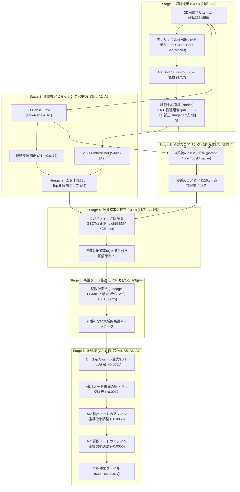
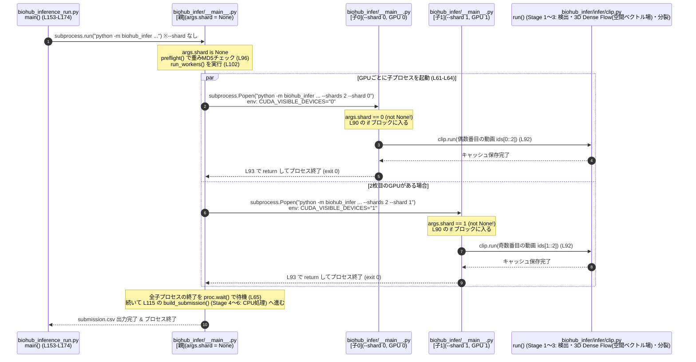
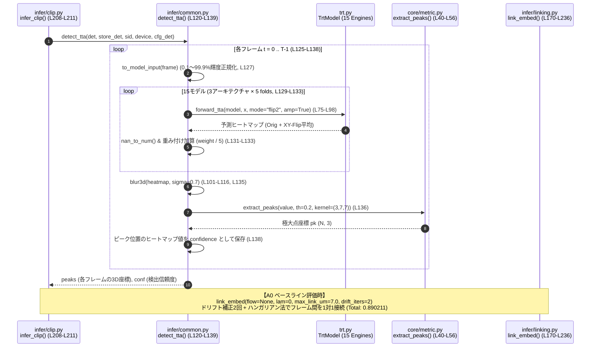
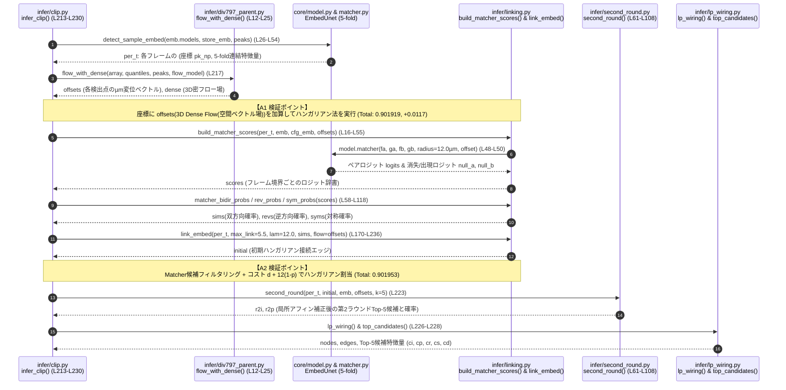
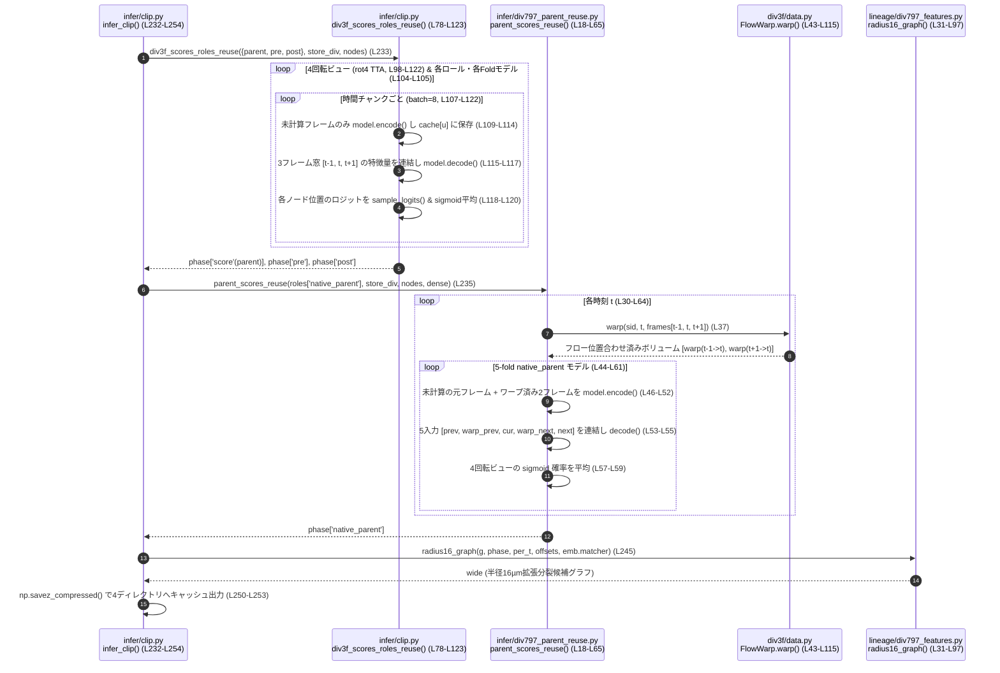
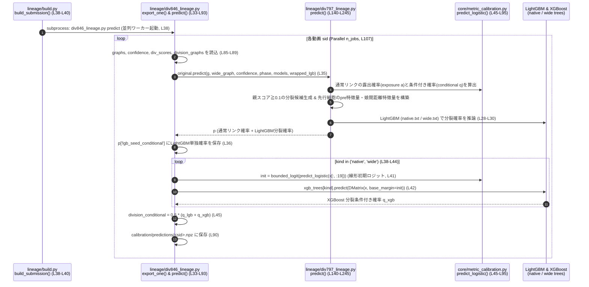
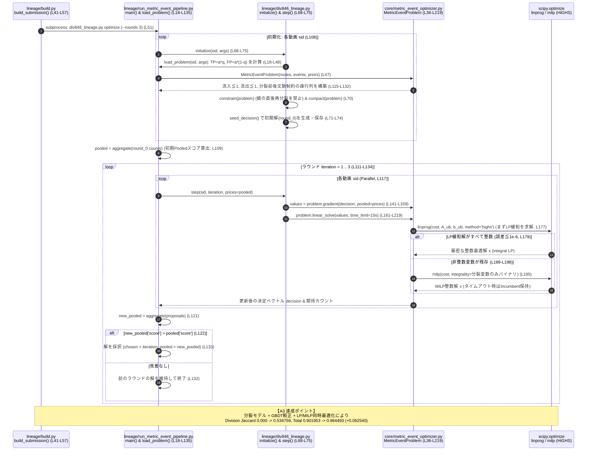
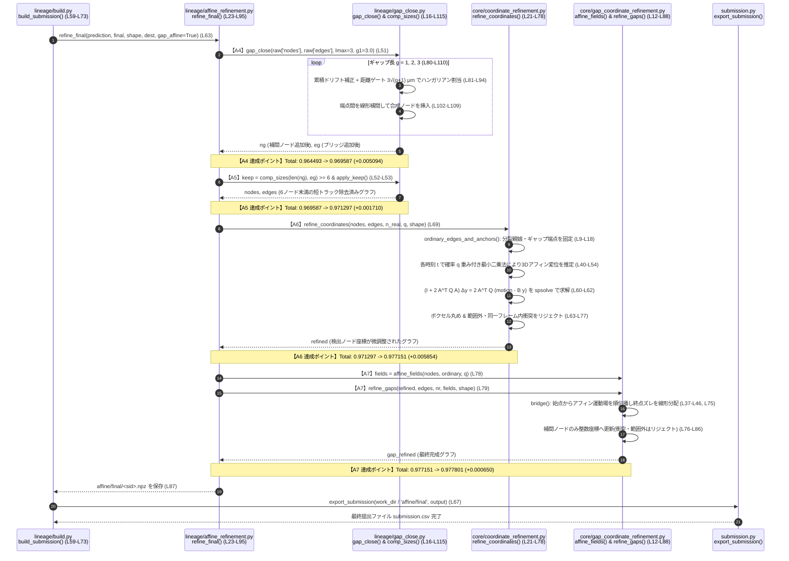

18-⑤Kaggle実践3 Biohub細胞トラッキング 3位解法のまとめ


## Abstract
- biohub 3位解法(yu4u / ren4yuさん Private 0.96918 / Public 0.97832)のまとめ

※この方日本人なんですね。。。Kaggle Grandmasterだって。すごいや。

**用語解説**

- ドリフトベクトル ... フレーム(64×256×256)で1つのベクトル(Δz,Δy,Δx)。※1動画は100フレーム=フレーム境界t→t+1 は99。なので、ドリフトベクトルも99本存在する。
- 3D Dense Flow(空間ベクトル場) ... ボクセル座標(z,y,x) ごとのベクトル。


## 概要
先日、Biohub細胞トラッキングコンペが完了しました。
Private LB 1353位/3800人と大変悔しい結果に終わりましたが、Kaggleの素晴らしいところは、トップランカーたちの卓越した解法が惜しみなく公開されることです。
この学びの宝庫を徹底的に解析し、確実に自身のスキルへと昇華させるべく、今回は3位に入賞されたKaggle Grandmaster(yu4u / ren4yuさん)の解法を深掘りします。

## biohub 3位の解法まとめ
3位の解法は、各ステージが極めて論理的かつ堅牢に設計されており、コンペ特有の「疎なアノテーション(全細胞の約2.8%)」と「極端に少ない分裂データ(全199動画でわずか151件)」という困難な課題に対して、王道かつ高度な機械学習・数理最適化技術を結集してアプローチしています。

- 解説のURL (Writeup)
https://www.kaggle.com/competitions/biohub-cell-tracking-during-development/writeups/3rd-place-solution
- ソースコード (Inference Notebook)
https://www.kaggle.com/code/ren4yu/biohub-inference-run

---

## プロジェクト構成

3位解法は、推論パッケージ本体(`biohub-inference`)と、学習済み重み群(`biohub-weights`)の2つのデータセットから構成されています。

```text
3rdPlaceSolution/
├── biohub-inference/                  # 推論パッケージ本体
│   ├── biohub_infer/
│   │   ├── __main__.py                # CLIエントリーポイント(検証、ワーカー起動、CSV出力)
│   │   ├── config.py                  # パイプライン定数、モデル構成、重みファイルマッピング
│   │   ├── trt.py                     # TensorRT 共有メモリランナー(TrtModel, TrtIO)
│   │   ├── core/                      # 共通モジュール
│   │   │   ├── model.py               # EmbedUnet(2.5D Siamese Matcher)
│   │   │   ├── dataset.py             # Zarrアクセス、CellStore、統計正規化
│   │   │   ├── matcher.py             # ノード間類似度スコアリング
│   │   │   ├── metric_event_optimizer.py # 整数計画法(Lineage LP)ソルバー本体
│   │   │   └── coordinate_refinement.py  # 座標アフィン微小調整
│   │   ├── infer/                     # GPU処理ステージ
│   │   │   ├── clip.py                # 動画単位の推論ドライバー(検出・マッチング・分裂)
│   │   │   ├── common.py              # TTA、ガウシアンブラー、ピーク検出、モデル読み込み
│   │   │   ├── linking.py             # Hungarian法、マッチング候補グラフ構築
│   │   │   └── div797_parent*.py      # フローワープ済み画像からの親細胞分裂スコアリング
│   │   ├── lineage/                   # CPU処理ステージ
│   │   │   ├── build.py               # 線形計画法・後処理ドライバー
│   │   │   ├── div846_lineage.py      # GBDT較正予測とLP制約生成
│   │   │   ├── gap_close.py           # 最大3フレームのギャップ補完
│   │   │   └── affine_refinement.py   # フロー場に基づく座標微調整
│   │   └── ssl_flow/                  # 3D Dense Flow (FlowNet3D)
│   └── wheels/                        # オフラインインストール用ホイール群
├── biohub-weights/                    # 学習済み重みファイル一式 (全70ファイル)
│   ├── dl_284_fold0~4_last.engine     # 検出器1: EfficientNetV2-L 2.5D U-Net (5-fold, TRT)
│   ├── dl_275_fold0~4_last.engine     # 検出器2: 3D SegResNet (5-fold, TRT)
│   ├── dl_492_fold0~4_last.engine     # 検出器3: EfficientNet-B7 2.5D U-Net (5-fold, TRT)
│   ├── dl_401_fold0~4_last.ckpt       # マッチャー: 2.5D EmbedUnet (5-fold, PyTorch)
│   ├── ssl_flow_flow_164_ep48.pt      # 3D Dense Flow(空間ベクトル場): FlowNet3D (PyTorch)
│   ├── div_415_*.engine               # 分裂親細胞モデル (parent, 5-fold, TRT)
│   ├── div_478_pre_*.engine           # 分裂前モデル (pre, 5-fold, TRT)
│   ├── div_478_post_*.engine          # 分裂後モデル (post, 5-fold, TRT)
│   ├── div_762_*.engine               # 元解像度親細胞モデル (native-parent, 5-fold, TRT)
│   ├── model_fold-1.json              # 較正器: LightGBM / XGBoost モデル定義
│   ├── native.txt / wide.txt          # GBDTツリー重みファイル
│   └── md5sums.txt                    # 重みチェックサム検証ファイル
├── biohub-inference-run.ipynb         # Kaggle / ローカル両対応推論ノートブック
├── biohub_inference_run.py            # 推論実行Pythonスクリプト
└── requirements.txt                   # 仮想環境再現用ファイル
```

### 主要モデル・重み一覧

| カテゴリ | モデル名・ファイル | アーキテクチャ / 規模 | 役割・機能 |
| :--- | :--- | :--- | :--- |
| **Detection (検出)** | `dl_284` (5-fold)<br>`dl_275` (5-fold)<br>`dl_492` (5-fold) | EfficientNetV2-L 2.5D U-Net (重み0.3)<br>3D SegResNet (重み0.3)<br>EfficientNet-B7 2.5D U-Net (重み0.4) | **細胞中心のヒートマップ検出:** 計15個のモデルアンサンブル。ガウシアンブラー(σ0.7)とNMS(3, 7, 7)で細胞中心ピークを抽出。実行時間の55%を占める最重要基盤。 |
| **Motion (運動)** | `ssl_flow_flow_164_ep48.pt` | 3D FlowNet (PyTorch) | **3D Dense Flow(空間ベクトル場)推定:** 連続フレーム間の3次元ボクセル変位場を推定し、細胞の運動を補正。マッチングと画像アライメントの双方に再利用。 |
| **Matching (対応付け)** | `dl_401_fold0~4_last.ckpt` | 2.5D Siamese EmbedUnet (5-fold) | **細胞埋め込み特徴抽出:** フレーム内の各細胞位置から埋め込みベクトルを抽出し、時間方向の対応付け確率(ロジット平均)を算出。 |
| **Division (分裂判定)** | `div_415` (parent)<br>`div_478_pre` (pre)<br>`div_478_post` (post)<br>`div_762` (native) | div3f エンコーダ/デコーダ (各5-fold、計40 engines) | **4系統の分裂ステージ分類:** rot4 TTA(4方向回転)と時間ウィンドウ間でのエンコーダ特徴量再利用により高速推論。親細胞・分裂前・分裂後を高精度に識別。 |
| **Calibration (較正)** | `model_fold-1.json`<br>`native.txt` / `wide.txt` | LightGBM / XGBoost / Logistic Regression | **候補スコアの確率較正:** 距離、フロー補正距離、マッチング確率、分裂スコアなど多様な特徴量を統合し、通常リンク確率と分裂イベント確率へ変換。 |
| **Optimization (最適化)** | `lineage/div846_lineage.py` | 整数計画法(Lineage LP) / SciPy LP | **大域的系譜グラフ構築:** 生物学的制約(流入次数<=1、流出次数<=2等)を満たしながら、対数オッズ比の総和を最大化。3ラウンド(各120秒)で最適解を探索。 |
| **Refinement (座標補正)** | `lineage/affine_refinement.py` | 局所アフィン変換補正 | **オプティカルフローに基づく座標微調整:** 検出ノードおよびギャップ補間ノードの位置をフロー場に沿って物理的に洗練。 |

---

## 3位解法の全体像

3位解法は、直感的なヒューリスティクスだけに頼るのではなく、**「強力な検出(A0)」→「フロー補正(A1)＋マッチング(A2)」→「専門化された分裂判定＋GBDT較正＋整数計画法による大域的一括解決(A3)」→「4段階の精密な後処理(A4〜A7)」**という極めて論理的な6段階パイプラインを構築しています。



---

## パイプラインの詳細解説

### Stage 1. Mainシーケンス(サブプロセス呼び出し)



---


### Stage 1. 細胞検出(Cell Detection): 実行時間の55%を投入した最重要基盤【対応: A0】

トラッキングの成否は「細胞が正しく検出されているか」に完全に依存します。検出漏れはトラッキングの途切れを生み、偽陽性は不正なエッジを誘発するため、作者は検出器のアンサンブルに最も大きな計算リソース(総実行時間の55%)を割り振りました。

* **3系統・計15個のモデルアンサンブル**:
  - `dl_284`: 2.5D U-Net(バックボーン: EfficientNetV2-L、重み 0.3)
  - `dl_275`: 3D SegResNet(MONAI実装、重み 0.3)
  - `dl_492`: 2.5D U-Net(バックボーン: EfficientNet-B7、重み 0.4)
  - それぞれ5-foldのクロスバリデーションモデルを用意し、オリジナル画像＋XY反転(`flip2` TTA)を掛け合わせた全15モデルの予測ヒートマップを重み付き平均。
* **ピーク検出処理**:
  - 平均ヒートマップに対して3D分離ガウシアンブラー($\sigma = 0.7$)を適用して微小ノイズを除去。
  - カーネルサイズ `(3, 7, 7)` の3D Max PoolingによるNMS(Non-Maximum Suppression)を実施。
  - 閾値 `0.2` 以上の極大点を細胞中心ノードとして抽出。
* **アブレーション `A0` (Detection with geometric linking) との関係**:
  - **スコア**: Adjusted Edge Jaccard `0.890211` / Division Jaccard `0.000000` / **Total `0.890211`**
  - 細胞検出だけではエッジ(時間方向の接続)が存在せずスコアが0になるため、Stage 1の検出性能を測るベースラインとして**「物理距離ゲート7 µm以内の1対1ハンガリアン法＋中央値変位による集団ドリフト補正(2回反復)」**でフレーム間を接続したものが **A0** です。フローやMatcher、分裂予測を一切使わない純粋な検出＋幾何リンクのみで `0.8902` という高い土台を達成しています。

#### Stage 1 関連ソースコードと行数
| ファイルパス | 関数・クラス・定数 | 行番号 | 処理内容 |
| :--- | :--- | :---: | :--- |
| config.py | `DETECTORS`, `DET_TTA`, `DET_BLUR_SIGMA`, `DET_THRESHOLD`, `NMS_KERNEL` | L9-L17 | 3系統検出器の重み(`0.3, 0.3, 0.4`)、`flip2`、`σ=0.7`、閾値`0.2`、NMS`(3,7,7)`の定義 |
| infer/clip.py | `load_models()` | L174-L189 | 15個のTensorRTエンジン(`dl_284`, `dl_275`, `dl_492` × 5-fold)のロード |
| infer/clip.py | `infer_clip()` 内の Stage ① 呼び出し | L208-L211 | `common.detect_tta()` を呼び出して各フレームのピーク座標と信頼度を取得 |
| infer/common.py | `forward_tta()`, `blur3d()`, `detect_tta()` | L75-L139 | TTA推論(L75-L98)、3Dガウシアンブラー(L101-L116)、アンサンブル合算とピーク抽出(L120-L139) |
| core/metric.py | `extract_peaks()` | L40-L56 | `F.max_pool3d` による `(3, 7, 7)` NMSピーク抽出 |
| infer/linking.py | `link_embed()` (`flow=None, lam=0` 時が **A0**) | L170-L236 | ドリフト補正2回反復(`drift_iters=2`)＋ハンガリアン法(`linear_sum_assignment`)による1対1接続 |

#### Stage 1 シーケンス図


---

### Stage 2. 3D Dense Flow(空間ベクトル場)と細胞マッチング(Dense Flow & Matching)【対応: A1, A2】
生物の細胞は組織全体の流動や自律的な移動を伴うため、単純なユークリッド距離だけでは誤った対応付けを起こします。

* **3D Dense Flow(空間ベクトル場) (FlowNet3D)**:
  - 連続するフレーム $t \to t+1$ 間の全ボクセルの変位場 $(\Delta z, \Delta y, \Delta x)$ を推定。
  - 前フレームの細胞座標をフローベクトルで移動補正し、見かけの移動を大幅にキャンセル。
* **EmbedUnet による細胞特徴量抽出**:
  - 2.5D Siamese UNet構造により、各細胞の周囲領域から32次元の埋め込み特徴ベクトルを抽出。
  - 2つの細胞間のコサイン類似度・内積から対応付け確証度を計算。
* **候補グラフの生成**:
  - フロー補正後の距離ゲート(12 µm以内)を満たす上位候補を抽出。
  - 初期割り当てとしてのHungarian法、および近傍半径12 µm以内のTop-5候補エッジを構築。
生物の細胞は組織全体の流動や自律的な移動を伴うため、単純なユークリッド距離だけでは誤った対応付けを起こします。Stage 2では「画像全体の3Dオプティカルフロー推定(**A1**)」と「細胞単位の外見・位置アテンションによるマッチング(**A2**)」の2段階アプローチで対応候補を絞り込みます。

#### Stage 2 関連ソースコードと行数
| ファイルパス | 関数・クラス | 行番号 | 処理内容 |
| :--- | :--- | :---: | :--- |
| infer/clip.py | `detect_sample_embed()`, `EnsembleMatcher`, `EnsembleEmb` | L26-L75 | 5-foldのEmbedUnetから各検出位置の特徴量をサンプリングして連結(L26-L54)、5-foldのMatcherロジットを平均(L57-L68) |
| infer/clip.py | `infer_clip()` 内の Stage ② 呼び出し | L213-L230 | 特徴量抽出 → 3D Dense Flow(空間ベクトル場)推定 → Matcherスコア算出 → 第2ラウンド推論 → LP初期配線とTop-5候補抽出 |
| infer/div797_parent.py | `flow_with_dense()` | L12-L25 | FlowNet3Dで連続フレーム間の変位場を推論し、各検出点の物理変位(`offsets`)と密な3Dフロー場(`dense`)を出力 |
| ssl_flow/inference.py | `point_priors()` | L84-L120 | 3Dフロー場から各細胞座標のサブボクセル変位ベクトルをトリリニア補間で取得 |
| infer/linking.py | `build_matcher_scores()`, `matcher_bidir_probs()`, `matcher_rev_probs()`, `matcher_sym_probs()` | L16-L118 | フロー変位補正付きでMatcherロジットを算出(L16-L55)し、双方向・逆方向(娘→親)・対称の3種の確率行列へ変換(L58-L118) |
| infer/linking.py | `link_embed()` (**A1**: `flow=offsets, lam=0` / **A2**: `flow=offsets, lam=12.0, sims=sims`) | L170-L236 | フロー補正＋ドリフト補正＋コスト $d + \lambda(1-p)$ によるハンガリアン割り当て |
| infer/second_round.py | `second_round()` | L61-L108 | 初期リンクから推定した局所アフィン運動場で再度Matcherを実行し、第2ラウンドのTop-5候補(`r2i, r2p`)を取得 |
| infer/lp_wiring.py | `top_candidates()`, `lp_wiring()` | L42-L69, L125-L141 | 各ノードの上位5候補(`cand_idx`, `cand_prob`, `cand_rev`, `cand_sym`, `cand_dist`)と初期LP配線エッジを抽出 |

#### Stage 2 シーケンス図


---

### Stage 3. 分裂同定(Division Identification): 4系統の専門モデル【対応: A3(前半)】
細胞分裂(1つの親細胞が2つの娘細胞に分裂するイベント)は、全データ中でごく稀にしか起きず、アノテーションも極めて不足しています(全199動画でわずか151件)。3位解法では、分裂を単一の分類器で解くのではなく、**時間的役割と入力解像度が異なる4系統のモデル群(計40個のTensorRTエンジン)**に分割して解きました。

* **特徴量再利用 (Feature Reuse)**:
  - 重複する時間ウィンドウ間でエンコーダ特徴量をキャッシュして再利用することで、計算負荷の高い40個のTensorRT分裂エンジンを極めて効率的に動作させています。
* **rot4 TTA**:
  - 4方向の90度回転TTA(Test-Time Augmentation)を適用し、細胞の分裂軸の方向に依存しない安定したスコアを獲得。
1. **`native_parent` (元解像度・フローアライメント親モデル / メイン親モデル)**:
   - `(1, 2, 2)` ダウンサンプリングの高解像度グリッド上で、Stage 2で推定した3D Dense Flow(空間ベクトル場)(`dense`)を用いて前後のフレームを中心フレーム $t$ にワーピング(位置合わせ)し、**5つのボリューム `[元t-1, tへワープしたt-1, 元t, tへワープしたt+1, 元t+1]`** を入力します。
   - 通常の細胞移動による見え方の変化をワーピングで打ち消すことで、「1つから2つに分裂する純粋な形態変化」だけを鋭敏に捉えます。
2. **`parent` (3フレーム親細胞モデル)**:
   - 元画像の連続3フレーム `[t-1, t, t+1]` のみを入力とし、時刻 $t$ で分裂直前の親細胞である確信度を判定します。
3. **`pre` (分裂前モデル)**:
   - 時刻 $t$ の親と $t+1$ の娘からなる分裂に対し、時刻 $t-1$ の前駆細胞(precursor)を3フレーム入力 `[t-2, t-1, t]` から検知します。
4. **`post` (分裂後モデル)**:
   - 分裂直後の時刻 $t+1$ に出現した娘細胞を3フレーム入力 `[t, t+1, t+2]` から識別します。

* **特徴量再利用(Encoder Feature Reuse)と `rot4` TTA**:
  - 連続する時間ウィンドウ間で重複する元フレームの2Dエンコーダ特徴量をキャッシュ(`cache`)して使い回すことで、4方向回転(`rot4` TTA) × 5-fold × 4ロール = 80回分のデコーダ推論を高速に処理しています。
* **半径16 µm 追加分裂候補グラフ (`radius16_graph`)**:
  - 分裂時には娘細胞が大きく弾け飛ぶことがあるため、通常の12 µmゲートを広げ、親スコアが高いノードに対しては半径 **16 µm** まで候補探索範囲を拡張した追加分裂プール(`division_graphs/<sid>.npz`)を構築します。

#### Stage 3 関連ソースコードと行数
| ファイルパス | 関数・クラス | 行番号 | 処理内容 |
| :--- | :--- | :---: | :--- |
| config.py | `DIV_ROLES`, `DIV_FRAMES`, `DIV_GRID`, `DIV_TTA` | L22-L29 | 4系統モデル(`div_415`, `div_478_pre`, `div_478_post`, `div_762`)とフレーム数(`3,3,3,5`)、`rot4` TTAの定義 |
| infer/clip.py | `div3f_scores_roles_reuse()` | L78-L123 | `parent`, `pre`, `post` の3モデルについて、時間ウィンドウ間でエンコーダ特徴量をキャッシュ再利用しながら `rot4` TTA推論 |
| infer/div797_parent_reuse.py | `parent_scores_reuse()` | L18-L65 | 3D Dense Flow(空間ベクトル場)で前後フレームをワープさせ、`[prev, warp_prev, cur, warp_next, next]` の5入力で `native_parent` スコアを推論 |
| div3f/data.py | `FlowWarp.warp()` | L43-L115 | 前方フローと符号反転逆フローを用いた3Dボリュームのグリッドサンプリング(ワーピング) |
| lineage/div797_features.py | `radius16_graph()` | L31-L97 | 親スコア閾値以上のノードについて、フロー補正後半径16 µm以内の娘候補ペアを探索し追加分裂グラフを構築 |
| infer/clip.py | `infer_clip()` 内の Stage ④ 呼び出しと保存 | L232-L254 | 4種の分裂スコアと半径16 µmグラフを計算し、`graphs/`, `confidence/`, `div_scores/`, `division_graphs/` に保存 |

#### Stage 3 シーケンス図


---

### Stage 4. 候補スコアの確率較正(Calibration)【対応: A3(中盤)】
ニューラルネットが出力する生スコアや距離メトリクスを、後続の整数計画法で直接比較可能な**確率値(Log-odds)**へと変換します。

* **特徴量エンジニアリング**:
  - 物理距離、フロー補正後距離
  - Matcher 双方向スコア、候補ランク、マージン
  - 検出ヒートマップの信頼度(Confidence)
  - 分裂モデル群の親スコア、preスコア、postスコア、および前後の先行細胞への伝播スコア
* **モデル構成**:
  - LightGBM、XGBoost、ロジスティック回帰を組み合わせ、通常エッジの接続確率 $P(\text{edge})$ と、分裂イベントの成立確率 $P(\text{div})$ を極めて正確に較正。
ニューラルネットが出力する生スコアや距離メトリクスを、後段の整数計画法(Stage 5)の目的関数で直接比較可能な**「期待真陽性数(Expected TP)」と「期待偽陽性数(Expected FP)」**へと較正します。

* **疎なアノテーション(約2.8%)を克服する「2段階確率分解 ($a \times q$)」**:
  - 未アノテーションの細胞同士を繋いだ正しいリンクを「偽陽性(FP)」と誤学習してしまうのを防ぐため、各候補イベントが**「① アノテーション領域内にあり採点対象となる確率 $a$ (Exposure probability)」**と、**「② 採点対象となった条件下で正解である条件付き確率 $q$ (Conditional probability)」**の2つを別々に予測します。
  - これにより、最適化器に渡す期待TP寄与度を $a \times q$、期待FP寄与度を $a \times (1 - q)$ として正確に算出できます。
* **通常リンクと分裂イベントのモデル構成**:
  - **通常リンク**: 距離・双方向マッチング確率・ランク・マージン・検出信頼度・親/pre/postスコアを入力とするロジスティック回帰(`predict_logistic`)。
  - **分裂イベント(1次プール `native` / 16µm追加プール `wide`)**: 線形モデルの初期ロジット(`base_margin`)をベースに、**LightGBM**(`native.txt`, `wide.txt`)と**XGBoost**(`native.ubj`, `wide.ubj`)の両方で条件付き分裂確率を予測し、`0.5 : 0.5` でアンサンブル平均します(初期シード解の生成にはLightGBM単独確率 `lgb_seed_conditional` を使用)。

#### Stage 4 関連ソースコードと行数
| ファイルパス | 関数・クラス | 行番号 | 処理内容 |
| :--- | :--- | :---: | :--- |
| lineage/build.py | `build_submission()` 内の `_lineage('predict', ...)` | L38-L40 | サブプロセスで `div846_lineage.py predict` を並列実行 |
| lineage/div846_lineage.py | `predict()` | L33-L46 | `div797_lineage.predict()` で特徴量抽出とLightGBM予測を実行後、同じ特徴量でXGBoostを推論し `0.5` ずつブレンド |
| lineage/div846_lineage.py | `export_one()` | L78-L93 | 動画ごとにグラフ・信頼度・分裂スコアを読み込み、較正済み確率を `calibration/predictions/<sid>.npz` に保存 |
| lineage/div797_lineage.py | `predict()` (ベース特徴量生成 & LightGBM推論) | L140-L245 | 親スコア閾値 `0.1` での分裂候補ペア生成、先行細胞への `pre` スコア集約、娘ペア幾何特徴量の計算、LightGBM推論 |
| core/metric_calibration.py | `predict_logistic()`, `bounded_logit()` | L45-L95 | ロジスティック回帰による通常リンク・露出確率の推論とロジット変換 |

#### Stage 4 シーケンス図


---

### Stage 5. 系譜グラフ最適化(Lineage Graph Optimization): 整数計画法(LP/MILP)による一括解決【対応: A3(後半)】
局所的なハンガリアン法や貪欲法では、「通常リンクを先に確定すると、本来分裂の娘である細胞が別の親に奪われてしまい、後から分裂を追加できなくなる」という競合問題が起きます。Stage 5では、**保持するノード、通常リンク、分裂イベント(親1＋娘2の三つ組)を単一の数理計画問題として同時に選択**します。

* **アブレーション `A3` (Division models + Calibration + Joint LP/MILP optimization) の劇的効果**:
  - **スコア**: Adjusted Edge Jaccard `0.911017` (**+0.009064**) / Division Jaccard `0.534759` (**+0.534759**) / **Total `0.964493` (+0.062540)**
  - Stage 3の分裂モデル群、Stage 4の確率較正、そしてStage 5の同時最適化を一括導入したのが **A3** です(通常リンクの較正にも分裂特徴量を使い、分裂枝の生成にはLPが不可欠なためA3で同時導入されています)。
  - ここでDivision Jaccardが一気に `0.000 → 0.5348` へと立ち上がるだけでなく、12 µmゲートへの拡張と大域的なグラフ整合性制約によって通常エッジのJaccardも `0.9019 → 0.9110` へと大幅に改善し、トータルスコアが **+0.0625** 跳躍する最大のブレイクスルーとなっています。
* **生物学的整合性制約 (`MetricEventProblem` / `constrain`)**:
  1. **流入次数の制限**: 各細胞が持つ親は高々1つ($\text{in}(v) \le y_v$)。
  2. **流出次数の制限**: 各細胞からの出力イベントは「通常リンク1本」または「分裂イベント(娘2本を同時選択)1つ」の高々1つ($\text{out}(v) \le y_v$)。
  3. **分裂の前後文脈制約 (`require_division_context`)**: 分裂する親細胞は必ず通常の入力リンクを持たなければならず、2つの娘細胞はそれぞれ次の時刻へ通常の出力リンクを持たなければならない。
  4. **連続分裂の禁止 (`div763_constraint.py`)**: 娘細胞がその直後の時間境界で再び分裂することを禁止(データセットの時間解像度に基づく制約であり、偽陽性の連鎖を防止)。
* **コンペ評価指標の反復線形化と HiGHS ソルバー**:
  - コンペ公式スコア(Pooled Adjusted Edge Jaccard + 0.1 × Division Jaccard)を現在の解の周りでテイラー線形化(`gradient()`)し、各イベントの限界価値(報酬・コスト)を算出します。
  - HiGHSソルバーでまずLP緩和(`linprog`)を解き、非整数解が残った場合のみ分裂変数をバイナリ制約とした混合整数線形計画法(`milp`)を解きます。動画プール全体でカウントを集約しながら最大3ラウンド(`rounds=3`)係数を更新し、代理目的関数が改善したラウンドの解のみを採択します。

#### Stage 5 関連ソースコードと行数
| ファイルパス | 関数・クラス | 行番号 | 処理内容 |
| :--- | :--- | :---: | :--- |
| lineage/build.py | `build_submission()` 内の `_lineage('optimize', ...)` | L41-L57 | テスト動画プールごとに `div846_lineage.py optimize` を起動 |
| lineage/div846_lineage.py | `initialize()`, `seed_decision()` | L49-L50, L68-L75 | 問題行列を構築し、連続分裂禁止制約(`constrain`)と行列圧縮(`compact`)を適用後、初期実行可能解(`round_0`)を生成 |
| lineage/run_metric_event_pipeline.py | `load_problem()` | L18-L48 | 較正確率から各イベントの期待TP(`q * exposure`)・期待FP(`(1-q) * exposure`)を計算し `MetricEventProblem` を生成 |
| lineage/run_metric_event_pipeline.py | `main()` (反復最適化ループ) | L88-L135 | 全動画の期待カウントを集約(`aggregate`)し、最大3ラウンド×最大3試行の分数計画リトライで全体スコアを最大化 |
| core/metric_event_optimizer.py | `MetricEventProblem` (`__init__`, `gradient`, `linear_solve`) | L36-L219 | 流入・流出・分裂前後文脈の疎行列構築(L115-L132)、Pooled指標の勾配導出(L141-L159)、HiGHS LP緩和とMILP求解(L161-L219) |
| lineage/div763_constraint.py | `constrain()` | L1-L45 | 「娘細胞が直後のフレームで再び分裂する」イベントペアを禁止する制約行を追加 |

#### Stage 5 シーケンス図


---

### Stage 6. 後処理(Post-processing): スコアを極限まで押し上げる4つの仕上げ【対応: A4, A5, A6, A7】
Stage 5のLP最適化で得られた系譜グラフ(`raw/<sid>.npz`)に対して、コンペの評価指標(Adjusted Edge Jaccard & Division Jaccard)の性質に合わせて設計された**4段階の後処理(`A4` → `A5` → `A6` → `A7`)**を順番に適用します。

1. **アブレーション `A4`: Gap Closing — 最大3フレームのギャップ補完**:
   - **スコア**: Adjusted Edge Jaccard `0.916111` (**+0.005094**) / Division Jaccard `0.534759` / **Total `0.969587` (+0.005094)**
   - 一時的な検出漏れにより途切れたトラックの終点(出次数0)と後続トラックの始点(入次数0)を、既存リンクの中央値変位から推定した累積集団ドリフトで補正した上でハンガリアン法により接続します。
   - 欠損フレーム数 $g \in \{1, 2, 3\}$ の順番(短いギャップ優先)で処理し、距離ゲート $3\sqrt{g + 1}\text{ µm}$ 以内のペアを繋ぎ、中間フレームに線形補間ノードを挿入します。
2. **アブレーション `A5`: 短い連結成分の除去 (Short component removal)**:
   - **スコア**: Adjusted Edge Jaccard `0.918105` (**+0.001994**) / Division Jaccard `0.531915` / **Total `0.971297` (+0.001710)**
   - **A4** のギャップ補完を行った**後**に、Union-Findで弱連結成分のサイズを計算し、ノード数が **6個未満** の短い孤立トラックを除去します。
   - ※ギャップ補完(A4)を先に行うのは、短い断片がギャップ補完によって長い正当なトラックの一部へと繋がるケースを救済するためです。
3. **アブレーション `A6`: 検出ノード座標のアフィン微小調整 (Affine refinement of detected coordinates)**:
   - **スコア**: Adjusted Edge Jaccard `0.923141` (**+0.005036**) / Division Jaccard `0.540107` (**+0.008192**) / **Total `0.977151` (+0.005854)**
   - グラフの接続関係は固定したまま、NMSピーク抽出時のボクセル丸め誤差(ジッター)を補正してGT点とのマッチング精度を引き上げます。
   - 各フレーム境界の通常リンクの変位から、較正済み条件付き確率 $q$ を重みとする重み付き最小二乗法(`np.linalg.lstsq`)で3Dアフィン運動モデルをフィットします。
   - 「アフィン運動場との整合性(重み係数 `2.0`)」と「元の検出座標からのズレ最小化」のバランスをとる疎行列二次計画問題(`spsolve`)を解き、整数ボクセル座標へ丸めます。分裂の親・娘、ギャップ端点、補間ノードはアンカーとして固定し、範囲外や同一フレーム内での座標衝突を起こす移動はリジェクトします。これによりエッジだけでなくDivision Jaccardも `+0.0082` 向上します。
4. **アブレーション `A7`: 補間ノード座標のアフィン微小調整 (Affine refinement of interpolated coordinates)**:
   - **スコア**: Adjusted Edge Jaccard `0.923790` (**+0.000649**) / Division Jaccard `0.540107` / **Total `0.977801` (+0.000650) 【最終完全パイプライン】**
   - **A4** で単純な直線補間として挿入されたギャップ内ノードに対し、**A6** でフィットした各フレームのアフィン運動場(`affine_fields`)を適用します。
   - ギャップ始点からアフィン運動場に沿って順方向に座標を伝播させ、終点でのズレをギャップ期間全体に線形分配(`bridge()`)することで、周囲の細胞の曲線的な流れに沿った滑らかな補間軌道へと修正します。

#### Stage 6 関連ソースコードと行数
| ファイルパス | 関数・クラス | 行番号 | 処理内容 |
| :--- | :--- | :---: | :--- |
| lineage/run_metric_event_pipeline.py | `final_graph()` | L63-L85 | LP採択解から `raw` グラフを復元後、`gap_close`(**A4**) と `comp_sizes >= 6` フィルタ(**A5**)を適用して `final` に保存 |
| lineage/gap_close.py | `gap_close()` (**A4**), `comp_sizes()`, `apply_keep()` (**A5**) | L16-L36, L39-L115 | 累積ドリフト推定(L55-L63)、$g=1..l_{\max}$ のハンガリアン接続と線形補間ノード挿入(L80-L110)、連結成分サイズ計算(L23-L36) |
| lineage/build.py | `build_submission()` 内のアフィン補正ループ | L59-L73 | 各動画に対して `refine_final(..., gap_affine=True)` を呼び出し、最終 `submission.csv` を出力 |
| lineage/affine_refinement.py | `refine_final()` | L23-L95 | **A4**(`lmax=3, g1=3.0`)と**A5**(`>=6`)をリプレイして実検出ノードと補間ノードの対応を完全検証後、**A6**(`refine_coordinates`)と**A7**(`refine_gaps`)を順次実行 |
| core/coordinate_refinement.py | `ordinary_edges_and_anchors()`, `refine_coordinates()` (**A6**) | L9-L78 | 分裂・ギャップ端点のアンカー固定(L9-L18)、$q$重み付き最小二乗アフィンフィット(L40-L54)、疎行列連立一次方程式 `spsolve` による座標更新と衝突判定(L56-L78) |
| core/gap_coordinate_refinement.py | `affine_fields()`, `bridge()`, `refine_gaps()` (**A7**) | L12-L88 | 時刻ごとのアフィン行列抽出(L12-L34)、運動場伝播＋終点誤差線形分配(L37-L46)、補間ノードの座標更新と衝突判定(L49-L88) |
| submission.py | `export_submission()` | L1-L45 | 最終グラフ(`nodes`, `edges`)をコンペ提出フォーマットのCSVに変換 |

#### Stage 6 シーケンス図


---

## アブレーションスタディ: 段階的進化の軌跡(Stage 1〜6 との完全対応表)

著者らが199本の全トレーニング動画(OOF)で実施した、各ステージの追加・置き換えによるスコア向上の推移です(Table 1)。

| 実験ID | 対応Stage | 構成・変更点 | 主な該当ソースコード(行数) | 調整済み Edge Jaccard | Division Jaccard | トータルスコア |
| :--- | :--- | :--- | :--- | :--- | :--- | :--- |
| **A0** | **Stage 1** | 検出 + ハンガリアン法(ドリフト補正あり) | common.py(L120-L139)<br>linking.py(L170-L236) | 0.890211 | 0.000000 | 0.890211 |
| **A1** | **Stage 2 前半** | + 運動補正用3D Dense Flow(空間ベクトル場)(FlowNet3D) | div797_parent.py(L12-L25)<br>linking.py(L212-L222) | 0.901919 | 0.000000 | 0.901919 |
| **A2** | **Stage 2 後半** | + Matcher候補フィルタリング & 対応スコア | clip.py(L26-L75)<br>linking.py(L16-L118) | 0.901953 | 0.000000 | 0.901953 |
| **A3** | **Stage 3 + 4 + 5** | **+ 分裂モデル群 + GBDT較正 + 整数計画法(LP/MILP)同時最適化** | clip.py(L78-L123)<br>div797_parent_reuse.py(L18-L65)<br>div846_lineage.py(L33-L93)<br>metric_event_optimizer.py(L36-L219) | **0.911017** | **0.534759** | **0.964493** |
| **A4** | **Stage 6 (1/4)** | + ギャップクロージング(Gap closing: 最大3フレーム) | gap_close.py(L39-L115) | 0.916111 | 0.534759 | 0.969587 |
| **A5** | **Stage 6 (2/4)** | + 6ノード未満の短コンポーネント除去 | gap_close.py(L16-L36)<br>affine_refinement.py(L52-L53) | 0.918105 | 0.531915 | 0.971297 |
| **A6** | **Stage 6 (3/4)** | + 検出ノードのアフィン座標微小調整 | coordinate_refinement.py(L21-L78) | 0.923141 | 0.540107 | 0.977151 |
| **A7** | **Stage 6 (4/4)** | **+ 補間ノードのアフィン座標微小調整(最終完全パイプライン)** | gap_coordinate_refinement.py(L12-L88) | **0.923790** | **0.540107** | **0.977801** |

### アブレーションから得られる決定的な洞察
1. **A3での劇的なブレイクスルー (+0.0625)**:
   - A0〜A2は分裂イベントを生成しないためDivision Jaccardは0でしたが、A3で「4系統の分裂モデル」「GBDT較正」「整数計画法による一括最適化」を導入した瞬間に、スコアが **0.9019 → 0.9644** へと跳躍しました。
   - フローやMatcher単体(A1, A2)でのスコア向上は控えめに見えますが、これらの特徴量がA3の較正モデルに強力なエビデンスを提供しており、LP最適化と融合することで真の威力を発揮しています。
2. **後処理(A4〜A7)による着実な上積み (+0.0133)**:
   - ギャップ補完(A4)で +0.005、短トラック除去(A5)で +0.0017、そしてアフィン座標微調整(A6, A7)でさらに +0.0065 の向上を達成し、最終CV **0.9778** (Public LB: 0.977 / Private LB: 0.967) に到達しました。

---

## 1位・2位・3位解法の比較

| 項目 | 1位解法 (sersasj) | 2位解法 (soheilayati) | 3位解法 (yu4u / ren4yu) |
| :--- | :--- | :--- | :--- |
| **基本設計思想** | **ビジュアルトラッキング**<br>細胞の見た目変化・FPN占有マップから直接追跡 | **幾何ヒューリスティクス & 特徴量工学**<br>距離・速度・カルマンフィルタベース | **物理フロー補正 + 数理計画法(LP)**<br>3D Dense Flow + 4段分裂判定 + 整数計画法 |
| **検出器 (Detector)** | 3D U-Net (MAE事前学習 + 3Dベクトルフロー予測) | 3D U-Net (5-foldアンサンブル + 多段コンセンサス) | **2.5D U-Net (EffNetV2-L, B7) + 3D SegResNet** (実行時間の55%を投入) |
| **分裂(Division)の解法** | **Soon Net**<br>分裂前後3クラス分類 + 娘細胞占有マップ | **ペア特徴量 + 分裂スタッキング**<br>距離・形状特徴からGBDT/ペアモデル | **4系統の専門モデル (div3f)**<br>parent / pre / post / native-parent + rot4 TTA |
| **グラフ構築・追跡** | **貪欲法 (Greedy Decode)**<br>対数オッズ比による逐次決定 | **多段制約ソルバー**<br>Stage-6リランキング + フォーク投票 | **整数計画法 (Lineage LP)**<br>生物学的制約下での大域的一括最適化 |
| **後処理の工夫** | 線形平滑化 + ギャップ補完 + 短トラック除去 | 動的閾値 + カルマン速度ゲーティング | **オプティカルフローに基づくアフィン座標微調整** (A6, A7) |
| **高速化手法** | PyTorchモデルの軽量化 | Python/NumPyの並列化 | **TensorRT (T4 x2) への全エンジン化** + 特徴量再利用 |

---

## まとめ

Biohubコンペの3位解法は、
1. **「検出こそがすべての土台」**として計算時間の過半(55%)を強力なアンサンブル検出器に注ぎ込んだこと
2. 単純なユークリッド距離ではなく**「3D Dense Flow(空間ベクトル場)による運動補正」**を徹底したこと
3. 分裂現象を**「parent / pre / post / native」の4視点から専門モデル化**したこと
4. 局所的な追跡ミスを防ぐため**「整数計画法(LP)による大域的最適化」**で一括解決したこと
5. 最後に**「オプティカルフローに沿った座標のアフィン微小調整」**で限界まで削り出したこと

という、コンピュータビジョンと数理最適化が見事に融合した、極めて完成度の高いエンジニアリングの結晶でした。

本まとめが、細胞トラッキングや時系列3D画像解析、数理最適化コンペに挑戦される皆様の参考になれば幸いです。お役に立てれば。
